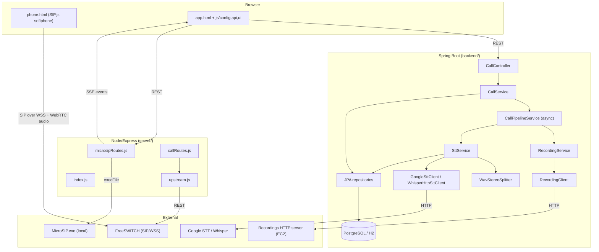
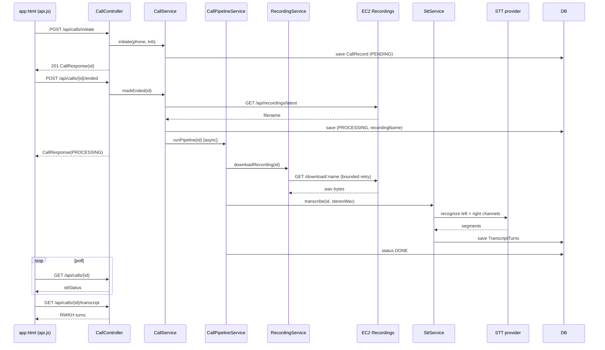
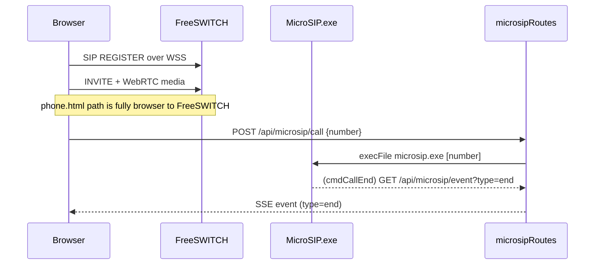

# Architecture

## System Overview

Two cooperating codebases plus external systems:

1. **Node/Express demo server** (`server/`) — serves the static frontend,
   controls the local MicroSIP desktop client, fans call events to the browser
   over SSE, and keeps a legacy FreeSWITCH REST BFF route.
2. **Spring Boot "call-assistant" backend** (`backend/`) — the post-call
   pipeline: open a call record, download the recording from the FreeSWITCH/EC2
   recording server, transcribe it (Vietnamese, RM/KH stereo split), persist and
   serve the transcript.
3. **Browser frontend** (`public/`) — a SIP.js WebRTC softphone
   (`phone.html`), a placeholder RM review view (`app.html` + `js/*`), and a
   legacy REST test page (`index.html`).
4. **External systems** — FreeSWITCH (SIP/WSS + recordings HTTP server on EC2),
   Google Cloud Speech-to-Text (default STT), optional self-hosted Whisper,
   PostgreSQL (or in-memory H2 in the demo profile).

## Architectural Style

**Hybrid, loosely-coupled services** — not a single monolith:
- The browser talks SIP/WebRTC **directly** to FreeSWITCH (no server in the
  media/signaling path for the softphone).
- The Node server is a thin BFF / device-control shim (MicroSIP + legacy REST).
- The Spring Boot backend is a conventional layered REST service
  (controller → service → repository) with a pluggable STT provider (Strategy
  via the `SttClient` interface and `@ConditionalOnProperty`).

Evidence: `public/phone.html` imports SIP.js and connects to `wss://host:7443`;
`server/index.js` serves pages and mounts routers only; `CallController` →
`CallService`/`RecordingService`/`CallPipelineService` → JPA repositories.

## Component Relationships

<!-- Text fallback: The Browser has two parts — phone.html (a SIP.js softphone)
and app.html with its js modules. phone.html speaks SIP-over-WSS and WebRTC
audio directly to FreeSWITCH. app.html calls the Spring Boot CallController over
REST and the Node microsipRoutes over REST, and receives SSE events back from
microsipRoutes. microsipRoutes runs MicroSIP.exe locally via execFile. The Node
callRoutes uses upstream.js to call FreeSWITCH's legacy REST API. In the
backend, CallController delegates to CallService, which triggers the async
CallPipelineService. The pipeline uses RecordingService (via RecordingClient,
HTTP to the EC2 recordings server) to fetch the .wav, then SttService (which
uses WavStereoSplitter to de-interleave stereo and GoogleSttClient/
WhisperHttpSttClient over HTTP to the STT provider). CallService and SttService
persist through JPA repositories to PostgreSQL or H2. -->

## Data Flow

A customer call becomes: call record (PENDING) → call ends → recording filename
resolved from "latest" → `.wav` downloaded (bounded retry) → stereo split into
RM/KH mono channels → each channel transcribed in Vietnamese → turns merged by
start time and persisted → UI polls status, then renders transcript + recording
link.

## Key Design Decisions

- **Browser-direct SIP/WebRTC** keeps the server out of the media path
  (simplifies the demo; shifts TLS/cert and NAT/TURN concerns to the client +
  FreeSWITCH).
- **Pluggable STT** behind `SttClient` (`google` default, `whisper` alternate)
  selected by `app.stt.provider` — swap providers without touching `SttService`.
- **In-process stereo split** in pure Java (`WavStereoSplitter`) — no ffmpeg
  dependency; limited to 16-bit PCM stereo, else single-stream fallback.
- **Async pipeline** (`@EnableAsync` + `@Async`) so `/ended` returns
  immediately and the UI polls `GET /api/calls/{id}`.
- **Config-first secrets** (`AppProperties`, env-wins) — intent is good, but
  live keys were committed anyway (see `code-quality-assessment.md`).

## Improvement Opportunities

- Introduce DB migrations (Flyway/Liquibase) in place of `ddl-auto`.
- Replace "latest filename" mapping with a real call↔recording correlation key.
- Stream recordings instead of fully buffering (64 MB cap today).
- Add tests, linting, and CI before layering the new LLM/UI work on top.

## Interaction Diagrams

### Post-call transcription pipeline (FR1/FR3/FR4)

<!-- Text fallback: The UI posts initiate; CallController calls CallService,
which saves a PENDING CallRecord and returns id. The UI posts {id}/ended;
CallService asks the EC2 recordings server for the latest filename, saves
PROCESSING with that recordingName, and starts the async CallPipelineService,
returning immediately. The pipeline calls RecordingService, which downloads the
.wav from the recordings server with bounded retry, then SttService, which sends
the left and right channels to the STT provider, maps the returned segments to
TranscriptTurns, and persists them; the pipeline sets status DONE. Meanwhile the
UI polls GET /api/calls/{id} until the status is terminal, then fetches the
transcript. -->

### Softphone call + MicroSIP event fan-out

<!-- Text fallback: For the SIP.js softphone, the browser registers and sends an
INVITE with WebRTC media straight to FreeSWITCH; the Node server plays no part.
For MicroSIP control, the browser posts to /api/microsip/call and
microsipRoutes runs microsip.exe with the number as an argv argument. MicroSIP's
lifecycle hooks call GET /api/microsip/event, and microsipRoutes broadcasts
those as Server-Sent Events back to the browser. -->
