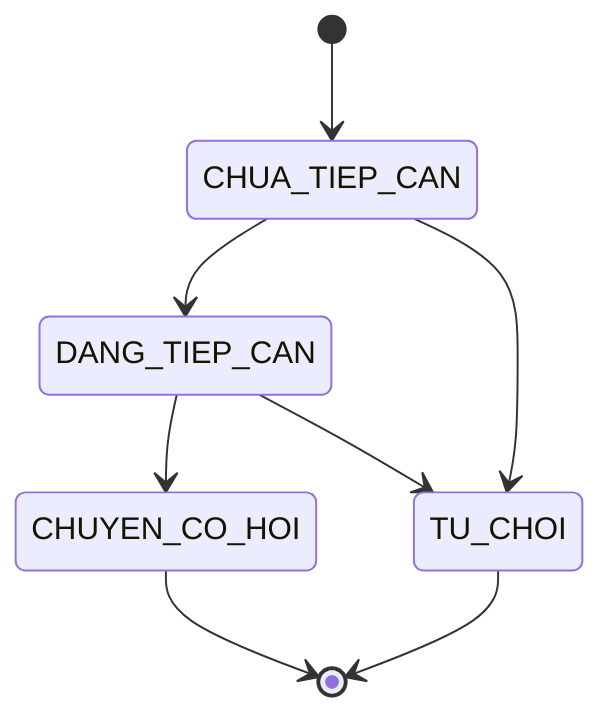
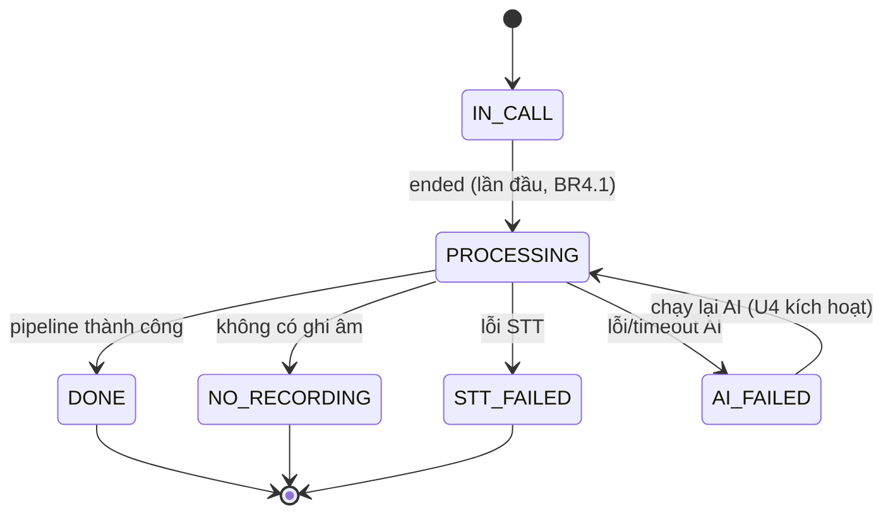
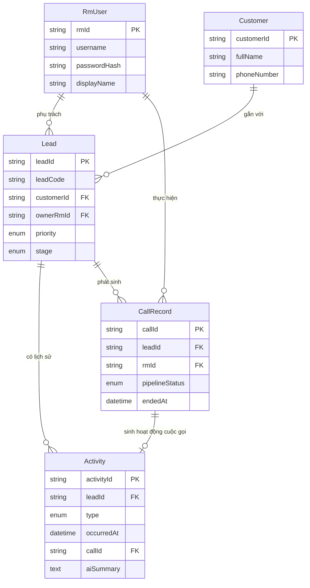

# Functional Specification — U1 `u1-lead-call-foundation`

Đặc tả hành vi của unit nền tảng Lead & cuộc gọi. Tài liệu này là **nguồn chân lý**
cho **luồng xử lý (workflow)** và **máy trạng thái (state machine)**. Hai phần ở cuối —
sơ đồ quan hệ thực thể và bảng tóm tắt quy tắc — là **view dẫn xuất** từ `entities.md`
và `rules.md` (nguồn chân lý của hai phần đó).

Phạm vi U1 (unit-of-work + story map): US1.1 (màn & kết thúc cuộc gọi), US4.3 (chi tiết
lead), US4.4 (gọi KH từ chi tiết lead); cộng FR1.4 (kiểm quyền phía server) và FR4.9
(chọn lead kế tiếp, phục vụ U4). Phần phân tích AI, keyin, lịch thuộc U4/U5.

---

## 1. Workflow (nguồn chân lý)

### WF1 — Xem chi tiết lead (US4.3)

1. Giao diện gọi `GET /api/leads/{leadId}` (hoặc `GET /api/leads/demo` ở chế độ demo).
2. Server lấy `currentRm` (BR1.3).
3. Server kiểm tra quyền sở hữu: nếu lead thuộc RM khác → `403` (BR1.1); nếu không tìm thấy lead của chính RM → `404` (BR1.2).
4. Trả `LeadDetail` gồm thông tin KH, các trường giai đoạn/ưu tiên/rankScore/SLA, khối Nội dung, Kịch bản bán (BR2.1).
5. Giao diện gọi `GET /api/leads/{leadId}/activities` để nạp Quản lý hoạt động; server trả Activity sắp theo `occurredAt` giảm dần (BR2.2).
6. Nếu danh sách hoạt động rỗng, giao diện hiển thị "Chưa có hoạt động" (AC4.3.2). Hoạt động cuộc gọi thiếu `aiSummary` hiển thị "Không có tóm tắt AI" (BR2.3).

Lỗi: `403`/`404` theo BR1.1/BR1.2; dữ liệu không đổi.

### WF2 — Gọi KH từ chi tiết lead (US4.4, FR1.5)

1. RM bấm **Gọi KH** ở màn chi tiết lead.
2. Giao diện gọi `POST /api/calls` với `{ leadId }`.
3. Server lấy `currentRm`, kiểm quyền lead (BR1.1). Lead của RM khác → `403`.
4. Server kiểm tra số điện thoại KH hợp lệ (BR3.1, BR6.3). Không hợp lệ → `400 VALIDATION_FAILED`, không tạo cuộc gọi (AC4.4.2).
5. Server kiểm tra giới hạn một cuộc gọi: nếu đang có cuộc gọi chưa xử lý xong → `409 CONFLICT` (BR3.2).
6. Server tạo `CallRecord` gắn `leadId` + `rmId`, `pipelineStatus = IN_CALL`, `startedAt = now`, trả `201` kèm `Call` (AC4.4.1).
7. Giao diện gọi `POST /api/microsip/call` (C6) để bắt đầu cuộc gọi qua MicroSIP, rồi mở màn Thực hiện cuộc gọi (WF3).

### WF3 — Màn thực hiện cuộc gọi (US1.1, FR2.1)

1. Màn mở với `callId` vừa tạo. Hiển thị trạng thái "Đang gọi", đồng hồ thời lượng tăng dần, khối thông tin KH (tab Thông tin KH / Chi tiết TNB / Lịch sử cuộc gọi) và panel Copilot (AC1.1.1). Panel Copilot thuộc U3; U1 cung cấp khung S2 và dữ liệu lead/cuộc gọi.
2. Giao diện có thể hỏi `GET /api/calls/{callId}` định kỳ (3 giây) để lấy trạng thái.
3. Cuộc gọi kết thúc theo WF4.

### WF4 — Kết thúc cuộc gọi, idempotent (US1.1, FR2.2)

1. Nguồn kích hoạt: RM bấm **Kết thúc**, hoặc MicroSIP phát sự kiện `end` qua SSE (C6) — giao diện gọi `POST /api/calls/{callId}/ended`. Sự kiện có thể đến **nhiều lần**.
2. Server lấy `currentRm`, kiểm quyền cuộc gọi (BR1.1). Khác RM → `403`.
3. Áp quy tắc kết thúc idempotent (BR4.1):
   - Nếu `endedAt` **chưa** đặt: đặt `endedAt`, tính `durationSeconds`, chuyển `pipelineStatus` `IN_CALL → PROCESSING`, **khởi chạy pipeline đúng một lần**.
   - Nếu `endedAt` **đã** đặt: no-op, trả trạng thái hiện tại (AC1.1.3) — pipeline không chạy lại.
4. Trả `200` kèm `Call`. Giao diện chuyển sang màn "Kết quả cuộc gọi" (AC1.1.2) — màn đó do U4 đảm nhận.

### WF5 — Điều phối pipeline (ranh giới U1/U4)

1. Sau khi vào `PROCESSING`, U1 điều phối vòng đời; `pipelineStep` lần lượt `FETCH_RECORDING → TRANSCRIBE → ANALYZE`.
2. U1 gọi TranscriptionComponent (U4, mã có sẵn) cho ghi âm + STT. Lỗi phân biệt được:
   - "chưa có ghi âm" → `NO_RECORDING`; "lỗi STT" → `STT_FAILED` (BR4.3).
3. Sau STT, U1 gọi các bước đã đăng ký qua `CallPipelineStep`; U4 đăng ký bước `ANALYZE`. **Chỉ U1 ghi trạng thái** qua `updatePipeline` (BR4.2).
4. Thành công đến cuối → `DONE`. Bất kỳ bước nào lỗi → trạng thái dự phòng tương ứng; không chặn keyin (xử lý ở U4).

### WF6 — Chọn lead kế tiếp (FR4.9, phục vụ U4)

1. Giao diện gọi `GET /api/leads/next?excludeLeadId=<leadId vừa gọi>`.
2. Server lấy tập lead của `currentRm` có `stage ∈ {CHUA_TIEP_CAN, DANG_TIEP_CAN}`, loại `excludeLeadId` (BR5.1).
3. Sắp theo `priority` (KHAI_THAC_NGAY > HOT_LEAD > THUONG), rồi `rankScore` giảm dần, rồi `slaDueAt` tăng dần.
4. Tập rỗng → `204` (giao diện báo "Bạn đã liên hệ hết tiềm năng bán cần xử lý"); ngược lại trả lead đầu tiên (`LeadSummary`).

---

## 2. State machines (nguồn chân lý)

### SM1 — Giai đoạn lead (`Lead.stage`)

<!-- Text fallback SM1: Lead bắt đầu ở CHUA_TIEP_CAN. CHUA_TIEP_CAN -> DANG_TIEP_CAN hoặc TU_CHOI. DANG_TIEP_CAN -> CHUYEN_CO_HOI hoặc TU_CHOI. CHUYEN_CO_HOI và TU_CHOI là trạng thái cuối. Việc cập nhật stage khi lưu keyin do U4 kích hoạt qua LeadService.updateStage; U1 sở hữu dữ liệu và thực thi tập chuyển hợp lệ. -->

Ghi chú: U1 sở hữu `Lead` và tập chuyển hợp lệ. Hành động chuyển trạng thái khi lưu keyin do U4 kích hoạt qua `LeadService.updateStage` (I1). Lead ở `CHUA_TIEP_CAN`/`DANG_TIEP_CAN` là ứng viên "lead kế tiếp" (BR5.1).

### SM2 — Trạng thái pipeline cuộc gọi (`CallRecord.pipelineStatus`)

<!-- Text fallback SM2: Cuộc gọi bắt đầu IN_CALL. Sự kiện ended lần đầu chuyển IN_CALL -> PROCESSING và chạy pipeline một lần (idempotent). Từ PROCESSING: -> DONE khi thành công; -> NO_RECORDING khi không có ghi âm; -> STT_FAILED khi lỗi STT; -> AI_FAILED khi lỗi/timeout AI. AI_FAILED -> PROCESSING khi RM bấm chạy lại AI (U4). DONE/NO_RECORDING/STT_FAILED là trạng thái cuối (keyin vẫn lưu được, xử lý ở U4). Chỉ U1 ghi trạng thái này (BR4.2). -->

`pipelineStep` (FETCH_RECORDING/TRANSCRIBE/ANALYZE) chỉ có giá trị khi `pipelineStatus = PROCESSING`; ở các trạng thái cuối, `pipelineStep = null`.

---

## 3. Sơ đồ quan hệ thực thể (view dẫn xuất từ `entities.md`)

> Nguồn chân lý của mô hình dữ liệu là khối YAML trong `entities.md`. Sơ đồ này chỉ để đọc nhanh.

<!-- Text fallback ER: RmUser 1-n Lead (ownerRmId) và 1-n CallRecord (rmId). Customer 1-n Lead (customerId). Lead 1-n Activity (leadId) và 1-n CallRecord (leadId). CallRecord 1-0..1 Activity (callId, hoạt động cuộc gọi). Các thực thể TranscriptTurn/CallAnalysis/CallKeyin/Task do U4/U5 sở hữu, không vẽ ở đây. -->

---

## 4. Tóm tắt quy tắc (view dẫn xuất từ `rules.md`)

> Nguồn chân lý của quy tắc là khối YAML trong `rules.md`.

| ID | Tóm tắt | Workflow áp dụng |
|---|---|---|
| BR1.1 / BR1.2 | Kiểm quyền sở hữu lead/cuộc gọi (403/404) | WF1, WF2, WF4 |
| BR1.3 | RM hiện tại: demo = RM mẫu; login = token | mọi WF |
| BR2.1 / BR2.2 / BR2.3 | Chi tiết lead đủ khối; lịch sử giảm dần; thiếu tóm tắt AI vẫn hợp lệ | WF1 |
| BR3.1 / BR3.2 | Tạo cuộc gọi: lead của RM + số hợp lệ; một cuộc gọi tại một thời điểm | WF2 |
| BR4.1 | Kết thúc idempotent, pipeline chạy đúng một lần | WF4 |
| BR4.2 / BR4.3 | Chỉ U1 ghi trạng thái; chuyển theo máy trạng thái SM2 | WF4, WF5 |
| BR5.1 | Chọn lead kế tiếp theo ưu tiên, loại lead vừa gọi | WF6 |
| BR6.1 | Không lộ/log passwordHash | mọi WF liên quan RmUser |
| BR6.2 / BR6.3 | Quy ước tiền/thời gian; kiểm hợp lệ đầu vào | WF1, WF2 |

---

## Sources

- `unit-of-work.md`, `unit-of-work-story-map.md` — phạm vi và thứ tự làm U1
- `requirements.md` — FR1.3, FR1.4, FR1.5, FR2.1, FR2.2, FR4.9
- `user-stories/stories.md` — US1.1 (AC1.1.1–3), US4.3 (AC4.3.1–2), US4.4 (AC4.4.1–2)
- `contract-summary.md` — C1 (REST), C6 (MicroSIP), I1/I2 (giao diện Java)
- `components.md` — hành vi LeadComponent, CallComponent, AuthComponent
- `entities.md`, `rules.md` (unit này) — nguồn chân lý cho view ER và tóm tắt quy tắc
