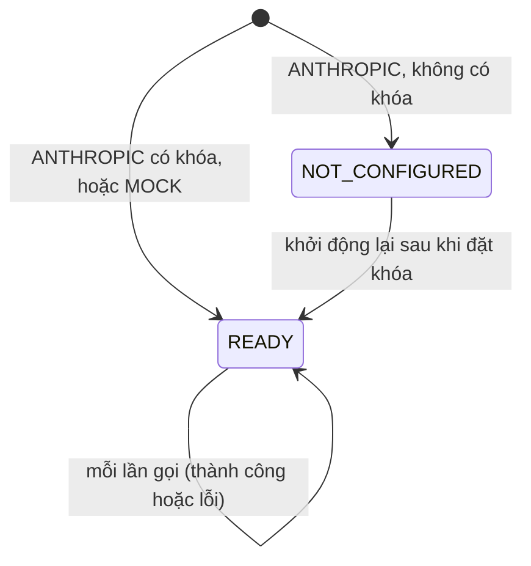
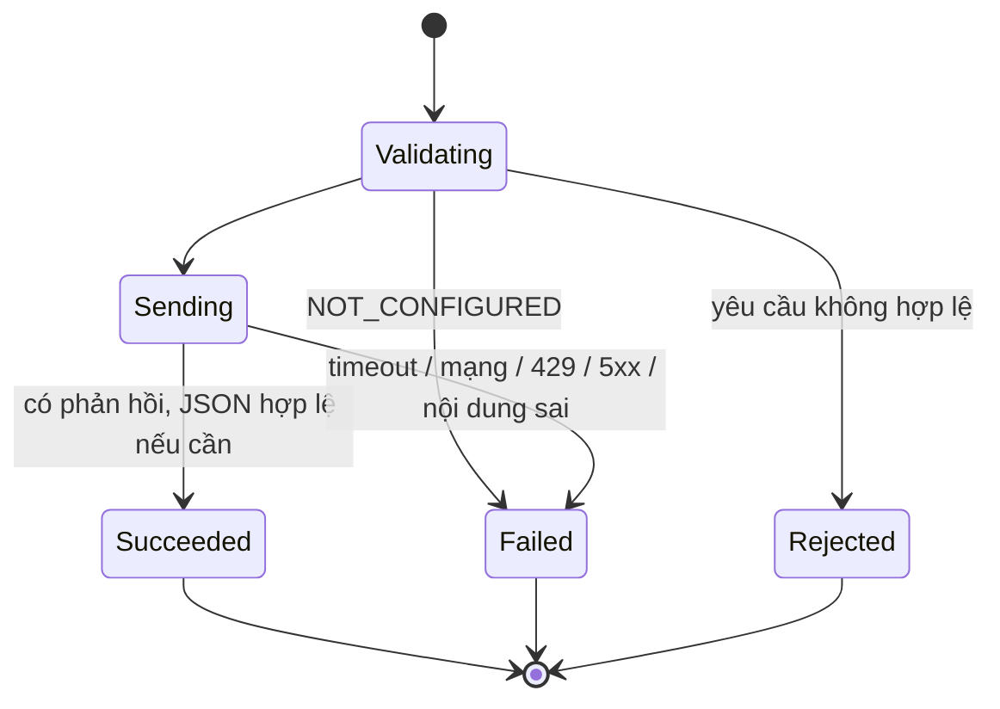
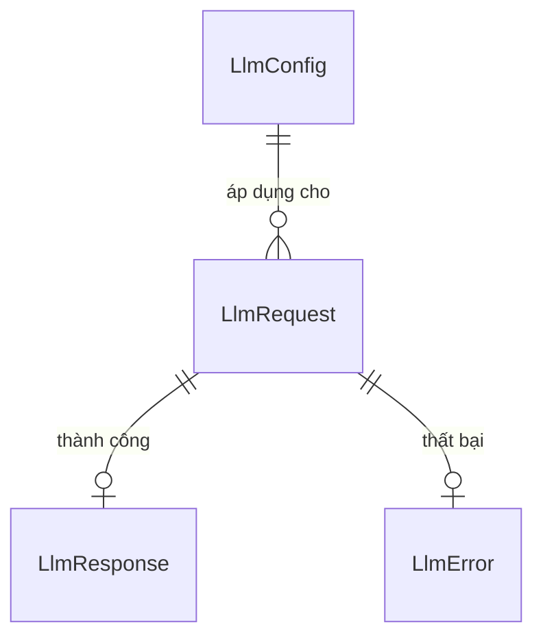

# Functional Specification — U2 `u2-llm-client`

Tài liệu này đặc tả hành vi của cổng LLM dùng chung (ADR-004, hợp đồng I3 trong `contract-summary.md`). Đây là **nguồn chân lý** cho luồng xử lý và máy trạng thái của thư viện. Bảng tóm tắt quy tắc ở cuối được dẫn xuất từ `rules.md`. U2 không có story riêng; thư viện phục vụ US1.2 (U3) và US2.1–US2.3 (U4), theo `unit-of-work-story-map.md`.

## 1. Workflow (nguồn chân lý)

### WF1 — Khởi động và nạp cấu hình
1. Ứng dụng khởi động và nạp `LlmConfig` từ cấu hình cùng biến môi trường (BR1.1).
2. Nếu `provider = ANTHROPIC` mà không có khóa API, hệ thống ghi một dòng log cảnh báo "LLM chưa cấu hình", **không ghi giá trị khóa**, và chuyển sang trạng thái `NOT_CONFIGURED`. Ứng dụng vẫn tiếp tục chạy.
3. Nếu `provider = MOCK`, hệ thống nạp các kết quả cài sẵn theo từng `purpose` (BR6.1).

### WF2 — Gọi LLM (`complete`)
1. Thành phần gọi (U3 hoặc U4) tạo một `LlmRequest`.
2. Kiểm tra yêu cầu (BR2.2). Nếu không hợp lệ thì từ chối ngay.
3. Nếu chưa cấu hình, ném `NOT_CONFIGURED` ngay, không gọi mạng (BR2.1).
4. Dựng thông điệp gửi đi: `systemPrompt` là chỉ dẫn; `cachedContext` và `userContent` được bọc trong khối phân tách là dữ liệu (BR5.1). Phần cố định được đánh dấu để dùng cache (BR5.2).
5. Gửi tới nhà cung cấp với timeout (BR3.1).
6. **Khi thành công**: nếu `expectJson`, kiểm tra kết quả có đọc được thành JSON hay không, cho phép bỏ khung ```` ```json ```` bao quanh (BR4.2). Sau đó trả `LlmResponse` kèm số token, độ trễ và cờ `truncated`.
7. **Khi lỗi**: phân loại lỗi (BR4.1) rồi ném `LlmError`, không tự thử lại (BR3.2).
8. Ghi một dòng log gồm purpose, model, latencyMs, số token, và loại lỗi nếu có. Không ghi nội dung prompt hay khóa (BR1.2).

### WF3 — Thành phần gọi xử lý lỗi (hướng dẫn cho U3 và U4)
| `LlmError.kind` | U3 Copilot | U4 CallAnalysis |
|---|---|---|
| NOT_CONFIGURED | Hiện lỗi trong panel ("AI chưa được cấu hình") | Đặt `AI_FAILED`, giao diện hiện dự phòng cột 1/3 |
| TIMEOUT / UNAVAILABLE / RATE_LIMITED | Hiện lỗi trong panel kèm nút "Gửi lại" (FR3.6) | Đặt `AI_FAILED`; RM có thể bấm "Thử phân tích AI lại" |
| BAD_RESPONSE | Hiện lỗi trong panel | Chạy lại tự động 1 lần (NFR3); nếu vẫn lỗi thì đặt `AI_FAILED` |

## 2. State machine (nguồn chân lý)

### SM1 — Trạng thái cổng (trong phạm vi tiến trình)


<!-- Text fallback SM1: Khi khởi động, cổng vào NOT_CONFIGURED nếu nhà cung cấp là ANTHROPIC mà chưa có khóa; ngược lại vào READY (có khóa, hoặc dùng MOCK). Từ NOT_CONFIGURED chỉ sang được READY khi ứng dụng khởi động lại sau khi đặt khóa. Ở READY, mỗi lần gọi, dù thành công hay lỗi, đều giữ nguyên READY: lỗi của từng lần gọi không làm đổi trạng thái cổng. -->

### SM2 — Một lần gọi


<!-- Text fallback SM2: Mỗi lần gọi bắt đầu ở bước kiểm tra (Validating). Yêu cầu không hợp lệ thì kết thúc ở Rejected. Chưa cấu hình thì kết thúc ở Failed với lỗi NOT_CONFIGURED. Nếu hợp lệ thì chuyển sang gửi (Sending). Từ Sending: có phản hồi, và JSON hợp lệ khi cần, thì kết thúc ở Succeeded; timeout, lỗi mạng, 429, 5xx hoặc nội dung sai thì kết thúc ở Failed kèm loại lỗi tương ứng. -->

## 3. Quan hệ thực thể (view dẫn xuất từ `entities.md`)


<!-- Text fallback ER: LlmConfig áp dụng cho mọi LlmRequest. Mỗi LlmRequest dẫn tới hoặc một LlmResponse (khi thành công), hoặc một LlmError (khi thất bại), không bao giờ cả hai. Không có thực thể nào được lưu xuống CSDL. -->

## 4. Tóm tắt quy tắc (view dẫn xuất từ `rules.md`)

| ID | Tóm tắt | Áp dụng ở |
|---|---|---|
| BR1.1 / BR1.2 | Khóa lấy từ biến môi trường; log không chứa khóa hay nội dung prompt | WF1, WF2 |
| BR2.1 / BR2.2 | Báo `NOT_CONFIGURED` ngay; kiểm tra yêu cầu | WF2 |
| BR3.1 / BR3.2 | Có timeout; không tự thử lại | WF2, WF3 |
| BR4.1 / BR4.2 | Phân loại 5 loại lỗi; kiểm tra JSON đọc được | WF2, WF3 |
| BR5.1 / BR5.2 | Tách dữ liệu khỏi chỉ dẫn; dùng prompt caching | WF2 |
| BR6.1 | Có bản giả lập (MOCK) | WF1 |

## Sources

- `unit-of-work.md` (U2), `unit-of-work-story-map.md`
- `requirements.md` (NFR1–NFR4, NFR6, FR3.6)
- `components.md` (LlmClient), `contract-summary.md` (I3), `decisions.md` (ADR-004)
- `entities.md` và `rules.md` của unit này
