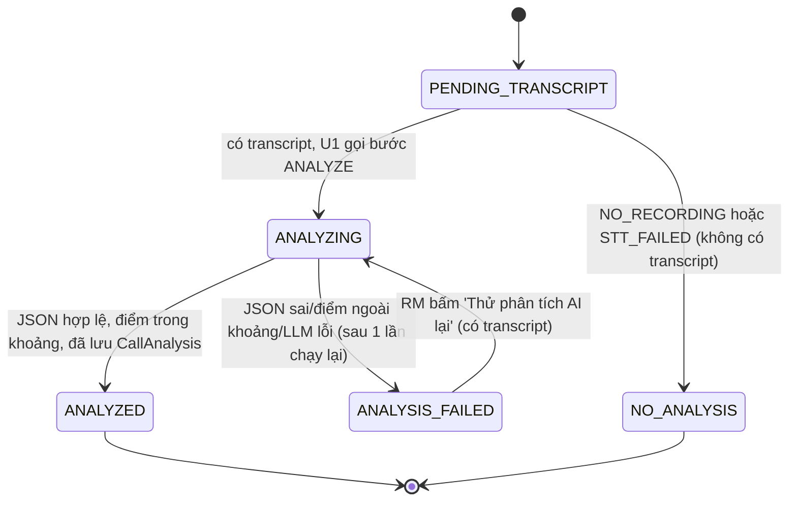
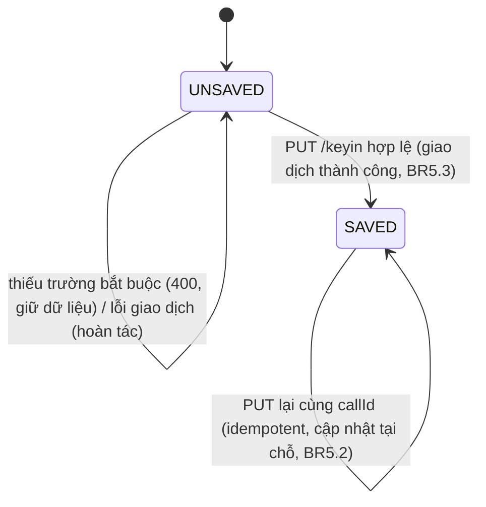
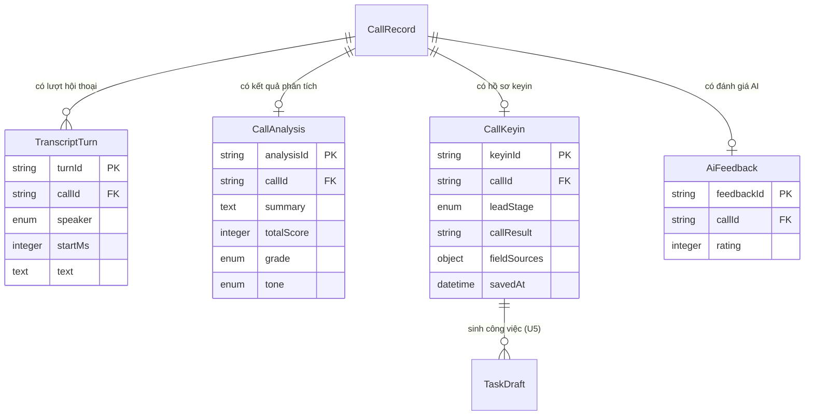

# Functional Specification — U4 `u4-call-analysis-result`

Đặc tả hành vi của unit Phân tích & Kết quả cuộc gọi. Tài liệu này là **nguồn chân lý**
cho **luồng xử lý (workflow)** và **máy trạng thái (state machine)**. Hai phần ở cuối —
sơ đồ quan hệ thực thể và bảng tóm tắt quy tắc — là **view dẫn xuất** từ `entities.md`
và `rules.md` (nguồn chân lý của hai phần đó).

Phạm vi U4 (unit-of-work + story map): US2.1 (pipeline, cột 2 hội thoại, tóm tắt),
US2.2 (chấm điểm), US2.3 (auto keyin, đánh giá AI, lưu), US2.4 (dự phòng khi lỗi,
điều hướng sau khi lưu), US3.1 (tóm tắt AI trong lịch sử). U4 cắm bước ANALYZE vào
pipeline của U1 (I2), dùng LlmClient của U2 (I3), gọi createFromCall của U5 (I4) và
cập nhật lead/hoạt động qua U1 (I1). U1 sở hữu `CallRecord` và là bên duy nhất ghi
`pipelineStatus`.

---

## 1. Workflow (nguồn chân lý)

### WF1 — Bước phân tích AI trong pipeline (US2.1, US2.2, FR4.1)

1. Sau khi STT xong, U1 gọi `CallPipelineStep.run(callId, transcriptTurns, leadContext)` cho bước `ANALYZE` (I2).
2. U4 yêu cầu U1 đặt `pipelineStep = ANALYZE`, `pipelineStatus = PROCESSING` qua `CallService.updatePipeline` (BR1.2).
3. U4 dựng prompt: `systemPrompt` là chỉ dẫn; transcript + thông tin lead đặt trong khối DATA phân tách là dữ liệu (BR8.1). Gọi `LlmClient.complete(expectJson=true)` (I3).
4. Kiểm tra kết quả (BR2.1): JSON phải đọc được, đủ trường bắt buộc, `criteriaScores` đúng 5 phần tử, mỗi điểm ∈ [0,10] bước 0,5 (BR2.2). Sai → chạy lại đúng một lần.
5. Nếu hợp lệ: tính `totalScore = round(tổng 5 tiêu chí × 2)` (BR3.1), suy ra `grade` (BR3.3), lưu `CallAnalysis` (một bản hiện hành / cuộc gọi), rồi yêu cầu U1 đặt `pipelineStatus = DONE`.
6. Nếu sau khi chạy lại vẫn sai (JSON hỏng / điểm ngoài khoảng / LLM lỗi/timeout): không lưu `CallAnalysis`, yêu cầu U1 đặt `pipelineStatus = AI_FAILED` (fallback FR4.8, BR2.3). Không bịa điểm (BR2.2).
7. Mọi bước ghi log `{ callId, step, latencyMs, outcome }`, không log khóa/prompt (BR8.2).

Lỗi: AI lỗi không chặn keyin — cuộc gọi vẫn mở với transcript (BR2.3).

### WF2 — Xem tiến trình & kết quả trên màn Kết quả cuộc gọi (US2.1, FR4.2)

1. Màn mở với `callId`. Giao diện hỏi `GET /api/calls/{callId}` (C1 của U1) định kỳ 3 giây để lấy `pipelineStatus`/`pipelineStep` (BR7.3).
2. Trong lúc `PROCESSING`: thanh tiến trình 3 bước (FETCH_RECORDING 'đang lấy ghi âm' → TRANSCRIBE 'đang chuyển giọng nói' → ANALYZE 'đang phân tích AI'), tự cập nhật, không cần tải lại trang (AC2.1.1).
3. Cột 2 (hội thoại): khi có transcript, giao diện gọi `GET /api/calls/{callId}/transcript` (C1) → trình phát audio (`GET /api/calls/{callId}/recording`), danh sách lượt RM/KH sắp theo `startMs` tăng dần, nút tải `.wav` (BR7.1, AC2.1.2).
4. Khi `DONE`: giao diện gọi `GET /api/calls/{callId}/analysis` (C3) → điền cột 1 (chấm điểm) và cột 3 (keyin đề xuất).
5. Ghi log mỗi bước phục vụ NFR6 (BR8.2).

### WF3 — Hiển thị chấm điểm, cột 1 (US2.2, FR4.4)

1. Giao diện đọc `CallAnalysis` từ `GET /api/calls/{callId}/analysis` (C3).
2. Hiển thị vòng điểm `totalScore/100` (do server tính, BR3.1), nhãn hạng A/B/C/D (BR3.3), 5 tiêu chí mỗi tiêu chí `score/10` kèm thanh tiến độ.
3. Hiển thị thẻ KH, giọng điệu (TICH_CUC / TRUNG_TINH / TIEU_CUC), insight điểm sáng + gợi ý nâng cao (AC2.2.2).
4. Nếu không có `CallAnalysis` (404 — đang xử lý hoặc AI lỗi): cột 1 hiển thị 'Chưa có điểm AI' theo loại lỗi (WF6).

### WF4 — AI Auto Keyin & lưu hồ sơ cuộc gọi (US2.3, FR4.5, FR4.7)

1. Giao diện gán `suggestedKeyin` của `CallAnalysis` vào form; mỗi trường do AI điền mang huy hiệu `AI · mm:ss` từ `SuggestedValue.sourceMs` (BR4.1). Trường không có trong transcript để trống (AC2.3.2).
2. RM sửa trường → huy hiệu đổi `RM đã sửa`; giao diện theo dõi nguồn từng trường (BR4.3).
3. RM nhập hai trường bắt buộc (leadStage, callResult), đánh giá AI (1–10, thẻ, góp ý), chỉnh danh sách công việc tiếp theo (mỗi dòng có `clientKey`).
4. RM bấm **Lưu hồ sơ cuộc gọi**: giao diện kiểm hai trường bắt buộc phía client; thiếu → cuộn tới trường lỗi, giữ nguyên dữ liệu (AC2.3.5). Nút khóa + vòng xoay để tránh bấm hai lần (AC2.3.6).
5. Gọi `PUT /api/calls/{callId}/keyin` (C3). Server:
   - kiểm quyền sở hữu cuộc gọi (BR5.5) → khác RM `403`;
   - kiểm leadStage/callResult (BR5.1) → thiếu `400 VALIDATION_FAILED`;
   - trong **một giao dịch** (BR5.3): lưu `CallKeyin` + `fieldSources`; lưu `AiFeedback` nếu có; `LeadService.updateStage` (I1); `LeadService.recordCallActivity` kèm bản sao `aiSummary`/`aiSuggestions` (I1, BR5.4); `TaskService.createFromCall(rmId, leadId, callId, nextTasks)` (I4).
6. Lưu idempotent theo `callId`: lưu lặp cập nhật keyin tại chỗ, `createFromCall` không tạo công việc trùng theo `(callId, clientKey)` (BR5.2, U5 BR2.1).
7. Trả `200 { callId, interactionCode, createdTaskIds }` (BR6.1). Giao diện mở hộp thoại S4 (WF5).

### WF5 — Điều hướng sau khi lưu, S4 (US2.4, FR4.9)

1. Hộp thoại S4 hiện 'Đã lưu hồ sơ cuộc gọi thành công!' với 3 lựa chọn (BR6.1, AC2.4.4):
   - **Liên hệ khách hàng tiếp theo**: giao diện gọi `GET /api/leads/next?excludeLeadId=<lead vừa gọi>` (U1, BR5.1). `204` (hết lead) → hiện 'Bạn đã liên hệ hết tiềm năng bán cần xử lý' rồi mở danh sách (AC2.4.5); ngược lại mở S1 lead kế tiếp (BR6.2).
   - **Chi tiết lịch làm việc**: mở màn Lịch làm việc S5 (U5), nổi bật công việc vừa tạo (`sourceCallId`).
   - **Đóng & Quay lại trang chủ**: về S1.
2. U4 chỉ điều hướng; việc chọn lead kế tiếp thuộc U1 (BR6.2).

### WF6 — Dự phòng khi lỗi (US2.4, FR4.8)

1. Theo `pipelineStatus` của U1, màn hiển thị dự phòng (BR7.2):
   - `NO_RECORDING`: cột1 'Chưa có điểm AI — không có ghi âm'; cột2 'Không tìm thấy ghi âm cho cuộc gọi này' (không trình phát); cột3 form trống (AC2.4.1).
   - `STT_FAILED`: cột1 'Chưa có điểm AI — chưa có transcript'; cột2 có trình phát + nút tải `.wav` + 'Không chuyển được giọng nói thành văn bản'; cột3 form trống (AC2.4.2).
   - `AI_FAILED`: cột1 'Chưa có điểm AI'; cột2 trình phát + transcript đầy đủ; cột3 form trống + nút **'Thử phân tích AI lại'**.
2. Mọi trường hợp: form keyin trống vẫn lưu được bình thường qua WF4 (BR2.3).
3. **Thử phân tích AI lại**: giao diện gọi `POST /api/calls/{callId}/analysis/retry` (C3). Chưa có transcript hoặc đang chạy → `409` (BR1.4). Hợp lệ → U1 đặt lại `PROCESSING/ANALYZE`, chạy lại WF1; khi có kết quả, giao diện **chỉ điền trường RM chưa nhập** rồi báo 'Đã điền N trường từ AI' (BR4.2, AC2.4.3).

### WF7 — Tóm tắt AI trong lịch sử hoạt động (US3.1, FR5.1)

1. Khi lưu keyin (WF4 bước 5), U4 ghi hoạt động cuộc gọi kèm bản sao `aiSummary`/`aiSuggestions` qua `LeadService.recordCallActivity` (I1). Bản sao độc lập, không đổi khi RM chạy lại AI sau đó (BR5.4, ADR-005).
2. Ở S1, RM xem Quản lý hoạt động (dữ liệu Activity do U1 phục vụ qua C1). Mỗi hoạt động cuộc gọi hiển thị tóm tắt/gợi ý AI chỉ đọc, thu gọn/mở rộng (AC3.1.1), kèm liên kết 'Xem kết quả cuộc gọi' mở S3 đúng cuộc gọi (AC3.1.2) — chỉ RM sở hữu mới mở được (O4).
3. Nếu `aiSummary = null` (lưu khi AI lỗi): hiển thị 'Không có tóm tắt AI'; keyin RM đã nhập vẫn hiển thị (AC3.1.3, BR7.4).

---

## 2. State machines (nguồn chân lý)

### SMA — Trạng thái phân tích AI của cuộc gọi

Đây là **máy trạng thái phân tích riêng của U4**, mô tả vòng đời của bước phân tích AI
trên một cuộc gọi. Nó **ánh xạ vào** `CallRecord.pipelineStatus` do U1 sở hữu (SM2 ở U1):
U4 không ghi trạng thái đó trực tiếp mà yêu cầu U1 ghi qua `updatePipeline` (BR1.2).

Máy trạng thái này **giải quyết phát hiện tư vấn ở U1** (SM2 có `AI_FAILED` nhưng không
có đường ra/kết thúc): ở đây `ANALYSIS_FAILED` là trạng thái **dừng-tạm ổn định
(terminal-for-now)**, và có đúng một đường ra là **chạy lại thủ công** đưa về
`ANALYZING`. Cần căn chỉnh với U1 SM2 bằng cách bổ sung cạnh `AI_FAILED → PROCESSING`
(chạy lại AI) — việc đó đã có trong U1 SM2 hiện tại; U4 **không** sửa file U1.

<!-- Text fallback SMA: Phân tích bắt đầu ở PENDING_TRANSCRIPT. Nếu có transcript, U1 gọi bước ANALYZE -> ANALYZING. Nếu không có transcript (NO_RECORDING hoặc STT_FAILED) -> NO_ANALYSIS (trạng thái cuối, form trống vẫn lưu). Từ ANALYZING: -> ANALYZED khi JSON hợp lệ, điểm trong khoảng và đã lưu CallAnalysis; -> ANALYSIS_FAILED khi JSON sai, điểm ngoài khoảng, hoặc LLM lỗi/timeout sau một lần chạy lại. ANALYSIS_FAILED là trạng thái dừng-tạm ổn định; đường ra duy nhất là RM bấm 'Thử phân tích AI lại' (chỉ khi có transcript) đưa về ANALYZING. ANALYZED và NO_ANALYSIS là trạng thái cuối. Trạng thái này ánh xạ vào CallRecord.pipelineStatus của U1 (PROCESSING/ANALYZE, DONE, NO_RECORDING, STT_FAILED, AI_FAILED); chỉ U1 ghi pipelineStatus (BR1.2). Việc chạy lại AI dùng cạnh AI_FAILED -> PROCESSING đã có ở U1 SM2 — U4 không sửa file U1. -->

**Ánh xạ SMA ↔ U1 SM2** (`CallRecord.pipelineStatus`):

| SMA (U4) | pipelineStatus (U1 SM2) | pipelineStep |
|---|---|---|
| PENDING_TRANSCRIPT | PROCESSING | FETCH_RECORDING / TRANSCRIBE |
| ANALYZING | PROCESSING | ANALYZE |
| ANALYZED | DONE | null |
| ANALYSIS_FAILED | AI_FAILED | null |
| NO_ANALYSIS | NO_RECORDING hoặc STT_FAILED | null |

### SMK — Trạng thái keyin của cuộc gọi (`CallKeyin`)

<!-- Text fallback SMK: Keyin bắt đầu ở UNSAVED. PUT /keyin hợp lệ và giao dịch thành công -> SAVED (lưu keyin + feedback + cập nhật stage + ghi hoạt động + tạo công việc trong một giao dịch). Nếu thiếu trường bắt buộc trả 400 và giữ nguyên dữ liệu (vẫn UNSAVED); nếu giao dịch lỗi thì hoàn tác toàn bộ (vẫn UNSAVED). Khi đã SAVED, PUT lại cùng callId là idempotent: cập nhật tại chỗ, không tạo keyin thứ hai và không tạo công việc trùng theo (callId, clientKey). -->

---

## 3. Sơ đồ quan hệ thực thể (view dẫn xuất từ `entities.md`)

> Nguồn chân lý của mô hình dữ liệu là khối YAML trong `entities.md`. Sơ đồ này chỉ để đọc nhanh.

<!-- Text fallback ER: CallRecord (do U1 sở hữu, tham chiếu) 1-n TranscriptTurn (callId); 1-0..1 CallAnalysis (callId); 1-0..1 CallKeyin (callId); 1-0..1 AiFeedback (callId). CallKeyin sinh các TaskDraft dùng để tạo Task qua TaskService.createFromCall của U5 (idempotent theo callId+clientKey). Các thực thể CallRecord, Lead, Activity, Task do U1/U5 sở hữu, chỉ tham chiếu, không định nghĩa ở U4. CriterionScore và SuggestedValue là value object nằm trong CallAnalysis (criteriaScores và suggestedKeyin). -->

---

## 4. Tóm tắt quy tắc (view dẫn xuất từ `rules.md`)

> Nguồn chân lý của quy tắc là khối YAML trong `rules.md`.

| ID | Tóm tắt | Workflow áp dụng |
|---|---|---|
| BR1.1 / BR1.2 | Bước ANALYZE cần transcript; U4 không ghi pipelineStatus, đi qua U1 | WF1 |
| BR1.3 / BR1.4 | Máy trạng thái phân tích SMA; chạy lại chỉ khi có transcript (else 409) | WF1, WF6, SMA |
| BR2.1 / BR2.2 | Kiểm JSON + điểm 0–10 bước 0,5; sai → chạy lại 1 lần, không bịa điểm | WF1, WF3 |
| BR2.3 | Lỗi AI không chặn lưu keyin | WF1, WF6 |
| BR3.1 / BR3.2 / BR3.3 | totalScore = round(tổng × 2); không dùng tổng LLM; hạng A/B/C/D | WF3 |
| BR4.1 | Giá trị đề xuất kèm sourceMs; trường không có → bỏ trống | WF4 |
| BR4.2 | Chạy lại AI chỉ điền trường RM chưa nhập | WF6 |
| BR4.3 | fieldSources: AI_KEPT / RM_EDITED / RM_ENTERED | WF4 |
| BR5.1 | Bắt buộc leadStage + callResult; thiếu → giữ dữ liệu, 400 | WF4 |
| BR5.2 | Lưu idempotent theo callId; không trùng công việc | WF4, SMK |
| BR5.3 / BR5.4 | Một giao dịch; hoạt động mang bản sao tóm tắt AI | WF4, WF7 |
| BR5.5 | Chỉ RM sở hữu đọc/lưu được (403) | WF3, WF4, WF6 |
| BR6.1 / BR6.2 | Hộp thoại 3 lựa chọn; lead kế tiếp dùng U1 | WF5 |
| BR7.1 / BR7.3 | Cột 2 trình phát + transcript; tiến trình pipeline tự cập nhật | WF2 |
| BR7.2 | Dự phòng theo loại lỗi; form trống luôn lưu được | WF6 |
| BR7.4 | Lịch sử: tóm tắt AI chỉ đọc + liên kết; thiếu → 'Không có tóm tắt AI' | WF7 |
| BR8.1 | Transcript là dữ liệu phân tách (chống prompt injection) | WF1 |
| BR8.2 | Log mỗi bước; không log khóa/prompt | WF1, WF2 |
| BR8.3 / BR8.4 | Quy ước tiền/thời gian; kiểm hợp lệ đầu vào | WF4 |

---

## Sources

- `unit-of-work.md`, `unit-of-work-story-map.md` — phạm vi và thứ tự làm U4
- `requirements.md` — FR4.1–FR4.9, FR5.1, NFR1, NFR2, NFR3, NFR6
- `user-stories/stories.md` — US2.1 (AC2.1.*), US2.2 (AC2.2.*), US2.3 (AC2.3.*), US2.4 (AC2.4.*), US3.1 (AC3.1.*)
- `refined-mockups/mockups.md`, `interaction-spec.md` — S3 (3 cột, trạng thái lỗi), S4 (điều hướng), S1 (khối tóm tắt AI)
- `contract-summary.md` — C3 (REST), C1 (trạng thái cuộc gọi/transcript/recording), I1 (updateStage/recordCallActivity/findNextLead), I2 (CallService/CallPipelineStep), I3 (LlmClient), I4 (createFromCall)
- `components.md` — hành vi CallAnalysisComponent, KeyinComponent, TranscriptionComponent
- `decisions.md` — ADR-004, ADR-005, ADR-006
- `construction/u1-lead-call-foundation/functional-design/{entities.md,rules.md,functional-spec.md}` — CallRecord/SM2, ranh giới pipeline, chọn lead kế tiếp
- `construction/u2-llm-client/functional-design/rules.md` — kiểm JSON, prompt injection, lỗi/timeout
- `construction/u5-task-calendar/functional-design/rules.md` — createFromCall idempotent, clientKey bắt buộc
- `entities.md`, `rules.md` (unit này) — nguồn chân lý cho view ER và tóm tắt quy tắc
