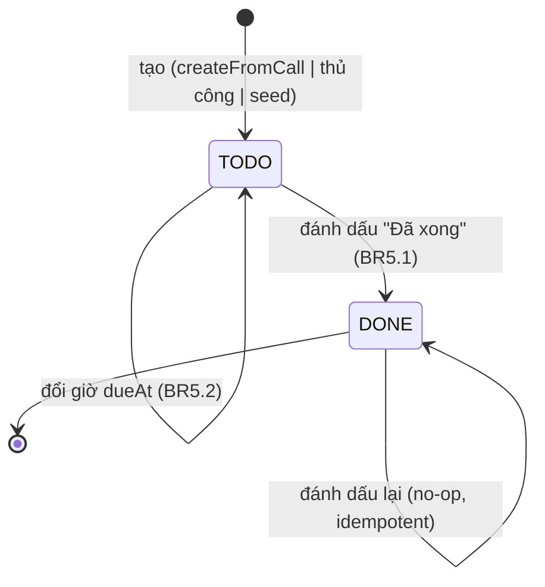
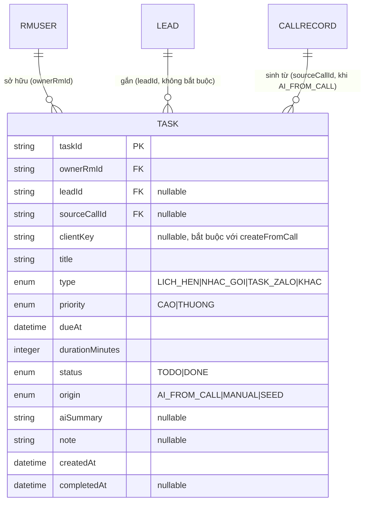

# Đặc tả hành vi — U5 `u5-task-calendar`

Tài liệu này là **nguồn chân lý về luồng hành vi và máy trạng thái** của unit
Công việc & Lịch làm việc: các luồng use case theo bước và chuyển trạng thái của
`Task`. Hình dạng dữ liệu nằm ở `entities.md`; logic quyết định nằm ở `rules.md`.
Sơ đồ ER và bảng tóm tắt quy tắc dưới đây là **view dẫn xuất** để dễ đọc.

Phạm vi U5 là một `service` nhúng trong Spring Boot (API C4 + I4) cộng hai màn
S5/S6 trên Node. Mọi luồng chạy dưới danh tính `currentRm` do U1 cung cấp
(`CurrentRmProvider`, I1); U5 không xác thực lại.

---

## 1. Máy trạng thái `Task.status` (nguồn chân lý)

Vòng đời công việc trong demo là một chiều: khởi tạo ở `TODO`, chuyển sang `DONE`
khi RM đánh dấu hoàn thành. Việc đổi giờ (`dueAt`) **không** đổi `status`.


<!-- Text fallback: Task bắt đầu ở trạng thái TODO khi được tạo (từ cuộc gọi, thủ công, hoặc seed). Ở TODO, đổi giờ dueAt vẫn giữ nguyên TODO. Từ TODO, đánh dấu "Đã xong" chuyển sang DONE và đặt completedAt. Đánh dấu lại khi đã DONE là no-op idempotent. Không có chuyển DONE -> TODO trong phạm vi demo. -->

Bất biến: `completedAt` khác null khi và chỉ khi `status = DONE` (xem
`entities.md` entity_constraints).

---

## 2. Các luồng hành vi (use case)

### UC1 — Tạo công việc từ cuộc gọi (I4, phục vụ U4) · AC3.2.1

Khi RM lưu hồ sơ cuộc gọi ở U4, U4 gọi `TaskService.createFromCall(rmId,
leadId, callId, TaskDraft[])`. Luồng idempotent theo `(callId, clientKey)`.

1. Nhận `currentRm` (I1); kiểm tra `rmId` khớp `currentRm` (BR1.1).
2. Nếu `leadId` khác null, gọi `LeadService.assertOwned(rmId, leadId)` — không thuộc RM → 403 (BR1.3).
3. Kiểm tra mọi `TaskDraft` có `clientKey` không rỗng — thiếu → 400 `VALIDATION_FAILED` (`details.field = clientKey`), không tạo gì (BR2.2).
4. Kiểm tra `title`, `dueAt`, `type ∈ {LICH_HEN, NHAC_GOI, TASK_ZALO}` của từng draft (BR3.1, BR3.2, BR6.2).
5. Với từng draft, tra `(sourceCallId=callId, clientKey)`:
   - đã tồn tại → trả lại `taskId` cũ (BR2.1);
   - chưa có → tạo `Task` mới: `origin = AI_FROM_CALL`, `sourceCallId = callId`, `status = TODO`, `aiSummary` = bản sao tóm tắt AI (BR2.3).
6. Trả danh sách `taskId[]` theo đúng thứ tự draft.

```text
# Pseudocode (minh hoạ, không ràng buộc hiện thực)
function createFromCall(rmId, leadId, callId, drafts):
  assertCurrentRm(rmId)                          # BR1.1
  if leadId != null: LeadService.assertOwned(rmId, leadId)   # BR1.3
  for d in drafts:
    require(d.clientKey)                          # BR2.2 -> 400 clientKey
    validate(d.title, d.dueAt, d.type)            # BR3.1/3.2/6.2
  result = []
  for d in drafts:
    existing = findByCallAndKey(callId, d.clientKey)   # BR2.1
    result.add(existing ?? insertTask(d, rmId, leadId, callId, AI_FROM_CALL))
  return result
```

Kết quả: khi RM mở S5 từ hộp thoại sau khi lưu, panel trái "AI Key-in từ cuộc
gọi" liệt kê đúng các công việc này (UC4) và lịch tuần đặt chúng đúng ô giờ.

### UC2 — Tạo công việc thủ công (S6) · AC3.3.5

1. Nhận `POST /api/tasks` với `TaskCreate`.
2. Kiểm tra `title` không rỗng — thiếu → 400 `title` (BR3.1); giao diện báo thiếu tiêu đề ngay dưới trường (S6).
3. Kiểm tra `dueAt` hợp lệ ISO-8601 +07:00 (BR3.1, BR6.1); `type`, `priority`, `durationMinutes ∈ {15,30,60}` (BR6.2).
4. Nếu `leadId` khác null → `assertOwned` (BR1.3); `type = KHAC` chỉ khi `leadId = null` (BR3.2).
5. Tạo `Task`: `origin = MANUAL`, `status = TODO`; trả 201 kèm `Task`.

### UC3 — Xem lịch tuần (mặc định) · AC3.2.2, AC3.2.4

1. Giao diện tính `[from, to]` của tuần đang xem (T2–T7) và gọi `GET /api/tasks?from&to`.
2. Server kiểm tra khoảng ≤ 42 ngày, `from ≤ to` (BR4.1); lọc `ownerRmId = currentRm` (BR1.1).
3. Trả mọi `Task` trong khoảng, gồm cả `DONE` và việc không gắn lead (BR4.4).
4. Giao diện xếp mỗi việc vào ô ngày/giờ; việc ngoài 08:00–17:00 hoặc Chủ nhật → dòng "Ngoài giờ" (BR4.2).
5. Nếu rỗng → "Không có công việc trong tuần này" (BR4.4).

### UC4 — Panel trái S5: "AI Key-in từ cuộc gọi" + "Lịch trình còn lại trong ngày" · AC3.2.1, AC3.2.5

1. Giao diện gọi `GET /api/tasks?sourceCallId=<callId vừa lưu>` → khối "AI Key-in từ cuộc gọi" (BR4.6); mỗi thẻ hiện ưu tiên, giờ, (sản phẩm/giá trị nếu có trong note), `aiSummary`; tô "Vừa lưu từ cuộc gọi".
2. "Lịch trình còn lại trong ngày": lọc từ kết quả tuần các `Task` của hôm nay có `status = TODO` và `dueAt ≥` hiện tại, sắp theo giờ.

### UC5 — Lọc theo loại · AC3.2.3

1. Giao diện gọi `GET /api/tasks?from&to&type=<loại>`.
2. Server trả đúng `Task` có `type` đó; `KHAC` không bao giờ nằm trong kết quả có lọc loại (BR4.3).
3. Bỏ lọc ("Tất cả") → gồm cả `KHAC`.

### UC6 — Đánh dấu hoàn thành · AC3.3.1

1. `PATCH /api/tasks/{taskId}` với `status = DONE`.
2. Kiểm tra sở hữu: không của RM → 403; không tồn tại trong phạm vi RM → 404 (BR1.1, BR1.2).
3. `TODO → DONE`, đặt `completedAt`; đã `DONE` → no-op idempotent (BR5.1).
4. Trả `Task`; giao diện hiển thị gạch ngang, nền xám, dấu ✓ (S5).

### UC7 — Đổi giờ · AC3.3.2, AC3.3.3

1. `PATCH /api/tasks/{taskId}` với `dueAt` mới (và `confirmPast` tuỳ chọn).
2. Kiểm tra sở hữu (BR1.1/BR1.2).
3. Nếu `dueAt < hiện tại` và `confirmPast != true` → 400 `VALIDATION_FAILED` (`details.field = dueAt`, `reason = PAST_NOT_CONFIRMED`); giao diện hiện cảnh báo vàng "Thời điểm này đã qua. Vẫn lưu?" (BR5.2, S6).
4. Khi hợp lệ hoặc đã xác nhận → cập nhật `dueAt`, giữ nguyên `status`; giao diện chuyển việc sang ô giờ mới.

### UC8 — Chuyển chế độ xem Ngày / Tháng / Danh sách · AC3.4.1, AC3.4.2

1. Ngày/Tháng: giao diện chỉ đổi `[from, to]` (vẫn ≤ 42 ngày, đủ cho Tháng) rồi gọi lại `GET /api/tasks` (BR4.5, BR4.1).
2. Danh sách: nhóm kết quả theo `status` thành "đã làm" (`DONE`) và "sắp tới" (`TODO`), mỗi nhóm sắp theo `dueAt` tăng dần (BR4.5).

### UC9 — Điều hướng "Gọi ngay" / "Chi tiết TNB" · AC3.3.4

1. Trên thẻ công việc có `leadId`, RM bấm "Gọi ngay" → giao diện mở màn Thực hiện cuộc gọi (luồng FR1.5 của U1) cho `leadId`.
2. "Chi tiết TNB" → mở màn Chi tiết lead (U1).
3. U5 không tạo cuộc gọi, không sửa lead — chỉ cung cấp `leadId` cho điều hướng (BR5.3).

---

## 3. View dẫn xuất — Sơ đồ quan hệ thực thể (ER)

Dẫn xuất từ `entities.md` (nguồn chân lý). `Task` là thực thể do U5 sở hữu;
`RmUser`, `Lead`, `CallRecord` thuộc U1/U6 (ngoài ranh giới), chỉ tham chiếu.


<!-- Text fallback: Task thuộc đúng một RmUser (ownerRmId, bắt buộc), có thể gắn không hoặc một Lead (leadId), và khi origin = AI_FROM_CALL thì trỏ tới đúng một CallRecord (sourceCallId). RmUser, Lead, CallRecord do U1/U6 sở hữu; U5 chỉ sở hữu Task. Task mang khoá chính taskId; các trường chính: clientKey (chống trùng, bắt buộc với createFromCall), title, type (LICH_HEN/NHAC_GOI/TASK_ZALO/KHAC), priority (CAO/THUONG), dueAt, durationMinutes, status (TODO/DONE), origin (AI_FROM_CALL/MANUAL/SEED), aiSummary, note, createdAt, completedAt. -->

---

## 4. View dẫn xuất — Tóm tắt quy tắc

Dẫn xuất từ `rules.md` (nguồn chân lý). Tra cứu đầy đủ ở `rules.md`.

| Nhóm | Quy tắc | Ý chính |
|---|---|---|
| Sở hữu | BR1.1–BR1.3 | Chỉ công việc của RM; gắn lead phải thuộc RM; 403/404 phân biệt theo phạm vi RM |
| Tạo từ cuộc gọi | BR2.1–BR2.3 | Idempotent theo (callId, clientKey); clientKey bắt buộc; origin AI_FROM_CALL + chép tóm tắt |
| Tạo thủ công | BR3.1–BR3.2 | title + dueAt bắt buộc; KHAC chỉ cho việc không gắn lead |
| Truy vấn & lịch | BR4.1–BR4.6 | Khoảng ≤ 42 ngày; tuần T2–T7 08:00–17:00 + 'Ngoài giờ'; lọc loại; hiện mọi việc; chế độ xem; khối sourceCallId |
| Thao tác | BR5.1–BR5.3 | TODO→DONE idempotent; đổi giờ quá khứ cần confirmPast; 'Gọi ngay'/'Chi tiết TNB' là điều hướng U1 |
| Quy ước | BR6.1–BR6.2 | ISO-8601 +07:00, Asia/Ho_Chi_Minh; kiểm tra đầu vào ở biên |

---

## 5. Trường hợp biên & lỗi

| Tình huống | Hành vi | Quy tắc |
|---|---|---|
| createFromCall gọi hai lần (lưu keyin lặp) | Lần hai trả lại taskId cũ, không tạo trùng | BR2.1, AC2.3.6 |
| TaskDraft thiếu clientKey | Từ chối toàn bộ lời gọi, 400 details.field=clientKey | BR2.2 |
| Tạo thủ công thiếu tiêu đề | 400 details.field=title; S6 báo tại trường | BR3.1, AC3.3.5 |
| Khoảng truy vấn > 42 ngày hoặc from>to | 400 VALIDATION_FAILED | BR4.1 |
| Tuần không có công việc | "Không có công việc trong tuần này" | BR4.4, AC3.2.4 |
| Việc ngoài 08:00–17:00 / Chủ nhật | Gom vào dòng 'Ngoài giờ' | BR4.2 |
| Lọc loại cụ thể | KHAC bị loại khỏi kết quả | BR4.3, AC3.2.3 |
| Đổi giờ sang quá khứ chưa xác nhận | 400 reason=PAST_NOT_CONFIRMED, cảnh báo vàng | BR5.2, AC3.3.3 |
| PATCH taskId của RM khác | 403; không đổi dữ liệu | BR1.1 |
| PATCH taskId không tồn tại của chính RM | 404 | BR1.2 |

---

## Sources

- `inception/user-stories/stories.md` — US3.2 (AC3.2.1–AC3.2.5), US3.3 (AC3.3.1–AC3.3.5), US3.4 (AC3.4.1–AC3.4.2), AC2.3.6
- `inception/requirements-analysis/requirements.md` — FR1.4, FR4.7, FR5.2–FR5.5
- `inception/contract-design/contract-summary.md` — C4 (endpoints, from/to, confirmPast, mã lỗi), I1 (assertOwned/currentRm), I4 (createFromCall)
- `inception/domain-design/components.md` — TaskComponent (hành vi, chép tóm tắt AI)
- `inception/refined-mockups/mockups.md` — S5 (lịch tuần, panel trái, bộ lọc, 'Ngoài giờ', Danh sách), S6 (tạo/đổi giờ, cảnh báo quá khứ)
- `entities.md`, `rules.md` (cùng unit — nguồn chân lý cho ER và tóm tắt quy tắc)
- `construction/u1-lead-call-foundation/functional-design/rules.md` — CurrentRmProvider, ownership
