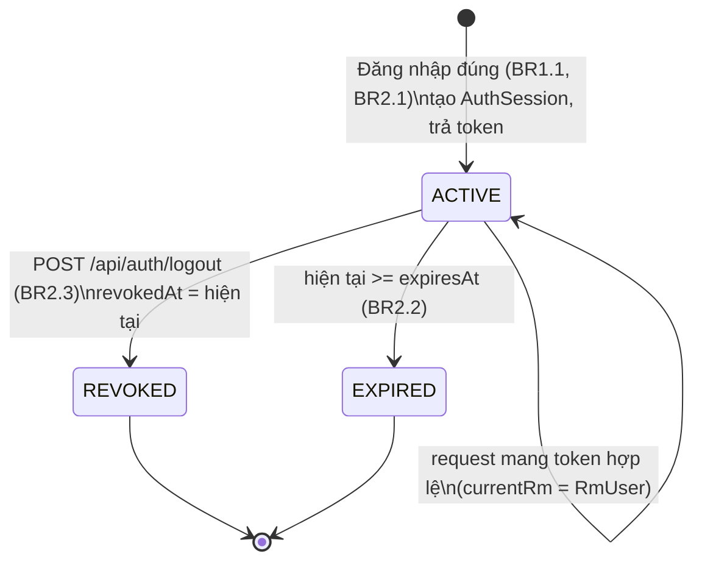
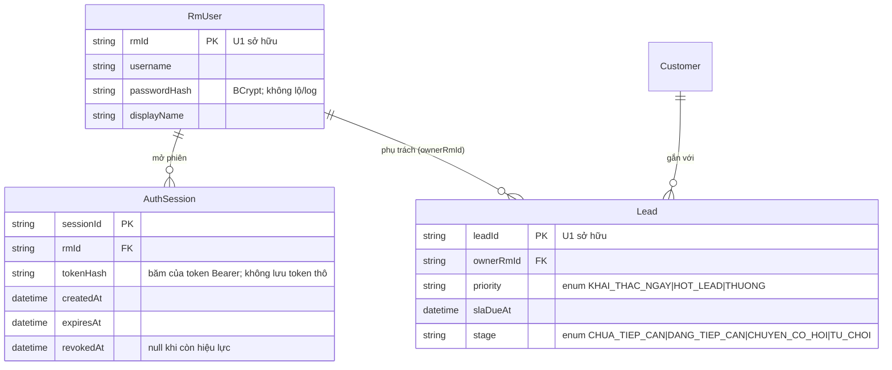

# Functional Spec — U6 `u6-login-lead-list`

Đặc tả hành vi của unit đăng nhập thật và danh sách lead theo RM. File này là
**nguồn chân lý cho các luồng (workflows) và máy trạng thái (state machine)** của
phiên đăng nhập. Hai phần cuối (`sơ đồ ER` và `tóm tắt quy tắc`) là **view phái
sinh** — nguồn chân lý tương ứng là `entities.md` và `rules.md`.

Phạm vi U6: ba điểm vào REST (`POST /api/auth/login`, `POST /api/auth/logout`,
`GET /api/leads`, hợp đồng C5) và bản hiện thực chế độ `login` của giao diện Java
`CurrentRmProvider` (I1) mà U1 định nghĩa. Mọi màn web nằm ở S0 (đăng nhập) và cột
danh sách lead trên S1.

## 1. Giải quyết các open note (chốt trong unit này)

- **Sở hữu đường dẫn** (open note contract-design): U6 chỉ sở hữu **đúng** collection
  path `GET /api/leads`. U1 sở hữu `/api/leads/demo`, `/api/leads/next` và
  `/api/leads/{leadId}` cùng các sub-path literal của nó. Các path literal (`/demo`,
  `/next`) **được ưu tiên** so với pattern `{leadId}` khi định tuyến, nên không có
  nhập nhằng giữa U6 và U1.
- **Thời hạn token** (open note C5): chốt mặc định **8 giờ**, đánh dấu **cấu hình
  được**. Đây là đề xuất cho demo, không phải ràng buộc cứng.
- **Chuyển demo → login** (ADR-007): U6 chỉ cung cấp bản hiện thực `login` của
  `CurrentRmProvider`; bản được dùng do cấu hình lúc khởi động quyết định (dependency
  injection). Không unit nào khác phải sửa mã khi đổi chế độ.

## 2. Workflows (nguồn chân lý)

### WF-1 — Đăng nhập (US4.1, FR1.1)

Màn: S0. Hợp đồng: `POST /api/auth/login`.

1. RM nhập `username` + `password` trên S0, bấm **Đăng nhập** (hoặc Enter trong ô mật khẩu).
   Trong lúc gửi, nút bị vô hiệu và hiện vòng xoay (chống bấm hai lần).
2. Server tra RmUser theo `username`.
3. Server kiểm tra `password` đối chiếu `passwordHash` BCrypt (BR1.1).
4. **Nếu đúng**: tạo `AuthSession` mới — sinh token Bearer ngẫu nhiên ≥ 32 byte, lưu
   `tokenHash`, đặt `createdAt`/`expiresAt` (hạn 8 giờ cấu hình được), `revokedAt = null`
   (BR2.1). Trả `200` với `{ token, expiresAt, rm }`. Giao diện lưu token (bộ nhớ phiên
   trình duyệt) rồi chuyển sang S1 và nạp danh sách lead (WF-3).
5. **Nếu sai** (username không có HOẶC password sai): trả `401` với thông điệp duy nhất
   `Sai tên đăng nhập hoặc mật khẩu`, không tạo phiên, không lộ trường nào sai (BR1.2).
   Giao diện hiển thị dòng lỗi kèm icon trên S0 (không chỉ dựa vào màu đỏ).
6. (Optional demo) Sau nhiều lần sai liên tiếp, server có thể thêm độ trễ nhỏ hoặc đếm
   lần sai (BR5.2).

Unhappy path: thiếu `username`/`password` → `400 VALIDATION_FAILED`.

### WF-2 — Đăng xuất và hết hạn phiên (AC4.1.3)

Hợp đồng: `POST /api/auth/logout`; mọi request mang `Authorization: Bearer <token>`.

1. **Đăng xuất chủ động**: giao diện gọi `POST /api/auth/logout` với token hiện tại.
   Server đặt `revokedAt = hiện tại` cho phiên (BR2.3), trả `204`. Giao diện xóa token và về S0.
2. **Phiên hết hạn / bị thu hồi**: với request bất kỳ ở chế độ login, server tra phiên theo
   `hash(token)`. Nếu không tìm thấy, đã thu hồi, hoặc `hiện tại >= expiresAt` → `401` (BR2.2).
   Giao diện bắt mọi `401`, xóa token và đưa RM về màn đăng nhập S0 (AC4.1.3).

### WF-3 — Xem danh sách lead của tôi (US4.2, FR1.2, FR1.4)

Màn: cột danh sách lead trên S1. Hợp đồng: `GET /api/leads`.

1. Sau khi đăng nhập (hoặc khi mở S1 với token hợp lệ), giao diện gọi `GET /api/leads` kèm
   `Authorization: Bearer <token>`.
2. Server xác định `currentRm` qua `CurrentRmProvider` (chế độ login: BR2.2 / BR3.1).
3. Server lấy các `Lead` có `ownerRmId = currentRm.rmId` (BR4.1), sắp theo `priority`
   (KHAI_THAC_NGAY > HOT_LEAD > THUONG) rồi `slaDueAt` tăng dần (BR4.2), trả `200` với mảng
   `LeadSummary`.
4. Giao diện hiển thị mỗi lead: `leadCode`, sản phẩm, nguồn, SLA còn lại, điểm `rankScore`/10,
   nhãn ưu tiên và trạng thái `stage` (mockup S1). Lead đang mở được tô viền xanh.
5. **Danh sách rỗng**: server trả `[]`; giao diện hiển thị `Chưa có tiềm năng bán` (BR4.3, AC4.2.3).

Lưu ý quyền: U6 KHÔNG tự chặn truy cập lead đơn lẻ của RM khác. Khi RM mở chi tiết một
lead (`GET /api/leads/{leadId}`, thuộc U1), U1 thực thi 403 cho lead của RM khác (BR1.1 của
U1, AC4.2.2). U6 chỉ bảo đảm danh sách không lộ lead của RM khác (BR4.1, AC4.2.1).

### WF-4 — Cung cấp danh tính RM cho các unit khác (I1, ADR-007)

1. Ở chế độ `login`, mọi unit cần "RM hiện tại là ai" đều gọi `CurrentRmProvider.currentRm()`.
2. Bản hiện thực của U6 đọc token Bearer của request, tra `AuthSession` còn hiệu lực (BR2.2),
   trả `RmUser` tương ứng. Thiếu/sai/hết hạn → ném lỗi xác thực → biên REST trả `401`.
3. Ở chế độ `demo`, bản của U1 được dùng (RM mẫu cố định); U6 không tham gia. Việc chọn bản
   nào do cấu hình khởi động quyết định (BR3.1).

## 3. Máy trạng thái phiên đăng nhập — AuthSession (nguồn chân lý)



<!-- Text fallback (máy trạng thái AuthSession):
- Trạng thái đầu: đăng nhập đúng tạo một AuthSession ở trạng thái ACTIVE và trả token Bearer (BR1.1, BR2.1).
- ACTIVE + request mang token hợp lệ: phiên giữ nguyên ACTIVE, server trả currentRm là RmUser của phiên (BR2.2).
- ACTIVE -> REVOKED: khi gọi POST /api/auth/logout, đặt revokedAt = hiện tại (BR2.3).
- ACTIVE -> EXPIRED: khi thời điểm hiện tại vượt expiresAt (BR2.2).
- REVOKED và EXPIRED là trạng thái cuối: mọi request dùng token của phiên này đều trả 401, giao diện đưa RM về màn S0 (AC4.1.3).
-->

Bất biến: một phiên chỉ **hợp lệ** khi `revokedAt = null` AND `hiện tại < expiresAt`.
Không có đường quay lại từ REVOKED/EXPIRED về ACTIVE — RM phải đăng nhập lại để có phiên mới.

## 4. Sơ đồ quan hệ thực thể (view phái sinh từ `entities.md`)

Nguồn chân lý của mô hình dữ liệu là `entities.md`. Sơ đồ dưới đây chỉ để đọc nhanh.



<!-- Text fallback (sơ đồ ER):
- AuthSession (do U6 sở hữu): sessionId (khóa), rmId (khóa ngoại tới RmUser), tokenHash (bản băm của token Bearer, không bao giờ lưu token thô), createdAt, expiresAt, revokedAt (null khi phiên còn hiệu lực).
- RmUser (do U1 sở hữu, U6 tham chiếu): rmId (khóa), username, passwordHash (BCrypt, không lộ/log), displayName. Một RmUser mở nhiều AuthSession và phụ trách nhiều Lead (qua ownerRmId).
- Lead (do U1 sở hữu, U6 chỉ đọc): leadId (khóa), ownerRmId (khóa ngoại), priority (enum), slaDueAt, stage (enum). Mỗi Lead gắn một Customer.
- Customer (U1 sở hữu) gắn với nhiều Lead.
-->

## 5. Tóm tắt quy tắc (view phái sinh từ `rules.md`)

Nguồn chân lý là `rules.md`. Tóm tắt để tra nhanh:

| ID | Tóm tắt |
|---|---|
| BR1.1 | Đăng nhập đúng khi username tồn tại + password khớp BCrypt |
| BR1.2 | Sai → một thông điệp "Sai tên đăng nhập hoặc mật khẩu", không lộ trường |
| BR2.1 | Token Bearer ≥ 32 byte, server chỉ lưu bản băm; hạn 8 giờ cấu hình được |
| BR2.2 | Request hợp lệ khi token khớp phiên chưa thu hồi/chưa hết hạn; ngược lại 401 |
| BR2.3 | Logout thu hồi phiên ngay |
| BR3.1 | U6 là bản login của CurrentRmProvider; chọn chế độ bằng cấu hình |
| BR4.1 | `GET /api/leads` chỉ trả lead của RM hiện tại |
| BR4.2 | Sắp theo ưu tiên rồi slaDueAt tăng dần |
| BR4.3 | Danh sách rỗng → "Chưa có tiềm năng bán" |
| BR5.1 | Không lộ/log mật khẩu thô, token thô, tokenHash |
| BR5.2 | (Optional) giảm nhẹ dò mật khẩu |

## 6. Pseudocode minh họa (≤ 15 dòng, chỉ để làm rõ thiết kế)

```
function currentRm(request):            # bản login của CurrentRmProvider (I1)
    token = bearerToken(request)        # từ header Authorization
    if token is null: raise Unauthorized
    session = findSessionByHash(hash(token))
    if session is null: raise Unauthorized
    if session.revokedAt != null: raise Unauthorized
    if now() >= session.expiresAt: raise Unauthorized   # BR2.2
    return rmUserById(session.rmId)
```

## Sources

- `requirements.md` — FR1.1, FR1.2, FR1.4, NFR2
- `user-stories/stories.md` — US4.1 (AC4.1.1–AC4.1.3), US4.2 (AC4.2.1–AC4.2.3)
- `contract-summary.md` — C5, I1, quy ước Bearer; open note thời hạn token và sở hữu đường dẫn
- `decisions.md` — ADR-002 (CORS), ADR-007 (demo/login bằng cấu hình)
- `refined-mockups/mockups.md` — S0 (màn đăng nhập), S1 (cột danh sách lead)
- `entities.md`, `rules.md` của chính U6 — nguồn chân lý cho sơ đồ ER và tóm tắt quy tắc
- `u1-lead-call-foundation/functional-design/` — hình dạng RmUser/Lead và BR1.1 (quyền sở hữu lead) mà U6 dựa vào
