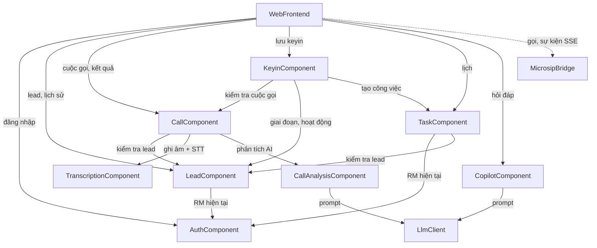

# Domain Design — Danh mục thành phần

Đầu vào:
- `requirements.md` (FR1–FR5, NFR1–NFR7)
- `stories.md` (US1.1–US4.4)
- `architecture.md` và `component-inventory.md` (mã hiện có)
- `team-practices.md`

Các quyết định đã chốt (`domain-design-questions.md`):
- [Q1=A] Mở rộng backend Spring Boot hiện có thành một khối nguyên khối có chia module.
- [Q2=A] Giữ server Node để phục vụ trang HTML và điều khiển MicroSIP/SSE.
- [Q3] Trích nội dung PDF ra file text/md, tìm kiếm đơn giản rồi nhúng kết quả vào prompt gửi Claude.

Tài liệu này chỉ chốt **chủ sở hữu và hình dạng** của thực thể. Kiểu dữ liệu và ràng buộc chi tiết để lại cho bước Functional Design. Cách đóng gói và triển khai do bước Units Generation quyết định.

```yaml
components:
  - name: AuthComponent
    summary: Đăng nhập RM và xác định RM đang thao tác cho mọi yêu cầu.
    behaviour: >
      Xác thực tên đăng nhập + mật khẩu băm BCrypt; tạo phiên có hạn; trả RM hiện tại cho các
      thành phần khác. Khi US4.1 chưa làm, trả về RM mẫu cố định (chế độ demo) thay cho phiên.
      Không bao giờ trả hay ghi log mật khẩu.
    responsibilities:
      - Xác thực RM và quản lý phiên (US4.1)
      - Cung cấp danh tính RM hiện tại cho kiểm tra quyền
    depends_on: []
    dependents:
      - component: LeadComponent
        interaction: lấy RM hiện tại để lọc và kiểm tra quyền sở hữu lead
        style: sync
      - component: TaskComponent
        interaction: lấy RM hiện tại để lọc công việc theo RM
        style: sync
      - component: WebFrontend
        interaction: gọi API đăng nhập / đăng xuất
        style: sync
    external_dependencies:
      - name: PostgreSQL / H2
        kind: database
        purpose: lưu tài khoản RM mẫu
    entities:
      - name: RmUser
        identifier: rmId
        attributes: [rmId, username, passwordHash, displayName]

  - name: LeadComponent
    summary: Khách hàng, tiềm năng bán (lead) và lịch sử hoạt động của lead.
    behaviour: >
      Chỉ trả lead thuộc RM hiện tại; mọi đọc/ghi lead của RM khác bị từ chối 403 (FR1.4).
      Quản lý giai đoạn lead (Chưa tiếp cận → Đang tiếp cận → Chuyển cơ hội / Từ chối).
      Lưu hoạt động của lead; hoạt động cuộc gọi mang bản sao tóm tắt/gợi ý AI do Keyin ghi vào
      để lịch sử hiển thị được kể cả khi AI lỗi (US3.1). Chọn "lead kế tiếp" theo ưu tiên trong
      trạng thái Chưa tiếp cận / Đang tiếp cận, loại lead vừa gọi (FR4.9).
    responsibilities:
      - Danh sách và chi tiết lead của RM (US4.2, US4.3)
      - Giai đoạn lead và chọn lead kế tiếp
      - Lịch sử hoạt động (US3.1)
    depends_on:
      - component: AuthComponent
        interaction: lấy RM hiện tại để kiểm tra quyền sở hữu
        style: sync
    dependents:
      - component: CallComponent
        interaction: kiểm tra lead thuộc RM và lấy số điện thoại khi tạo cuộc gọi
      - component: KeyinComponent
        interaction: cập nhật giai đoạn lead và ghi hoạt động cuộc gọi khi lưu keyin
      - component: TaskComponent
        interaction: kiểm tra lead thuộc RM khi công việc gắn với lead
      - component: WebFrontend
        interaction: hiển thị danh sách, chi tiết, lịch sử, lead kế tiếp
    external_dependencies:
      - name: PostgreSQL / H2
        kind: database
        purpose: lưu khách hàng, lead, hoạt động (dữ liệu seed cho demo)
    entities:
      - name: Customer
        identifier: customerId
        attributes: [customerId, fullName, segment, phoneNumber, age, occupation, estimatedIncome, address]
      - name: Lead
        identifier: leadId
        attributes: [leadId, leadCode, customerId, ownerRmId, productInterest, source, priority, rankScore, slaDueAt, stage, content, salesScript]
        references:
          - entity: RmUser
            owned_by: AuthComponent
            relationship: mỗi lead do đúng một RM phụ trách
      - name: Activity
        identifier: activityId
        attributes: [activityId, leadId, type, occurredAt, product, result, note, callId, aiSummary, aiSuggestions]
        references:
          - entity: CallRecord
            owned_by: CallComponent
            relationship: hoạt động loại cuộc gọi trỏ tới đúng một cuộc gọi

  - name: CallComponent
    summary: Vòng đời cuộc gọi và điều phối pipeline sau cuộc gọi.
    behaviour: >
      Tạo bản ghi cuộc gọi gắn lead + RM (FR1.5); đánh dấu kết thúc idempotent — sự kiện kết thúc
      lặp lại không chạy lại pipeline (AC1.1.3). Pipeline bất đồng bộ: lấy ghi âm "mới nhất"
      (giới hạn một cuộc gọi tại một thời điểm) → STT → phân tích AI; cập nhật trạng thái từng
      bước để giao diện theo dõi (FR4.2). Lỗi ở bước nào thì dừng ở trạng thái dự phòng tương ứng
      (Không có ghi âm / Lỗi STT / Lỗi AI) và không chặn keyin (FR4.8). Cho phép chạy lại riêng
      bước phân tích AI.
    responsibilities:
      - Tạo / kết thúc cuộc gọi (US1.1, US4.4)
      - Điều phối pipeline và trạng thái xử lý (US2.1, US2.4)
      - Phục vụ ghi âm và transcript cho giao diện
    depends_on:
      - component: LeadComponent
        interaction: kiểm tra quyền và lấy thông tin lead khi tạo cuộc gọi
        style: sync
      - component: TranscriptionComponent
        interaction: tải ghi âm và chuyển giọng nói thành transcript RM/KH
        style: sync
      - component: CallAnalysisComponent
        interaction: yêu cầu phân tích AI từ transcript + thông tin lead
        style: sync
    dependents:
      - component: KeyinComponent
        interaction: kiểm tra cuộc gọi tồn tại, thuộc RM, và đọc kết quả phân tích để lưu kèm
      - component: WebFrontend
        interaction: tạo/kết thúc cuộc gọi, theo dõi trạng thái, lấy kết quả, chạy lại AI
    external_dependencies:
      - name: PostgreSQL / H2
        kind: database
        purpose: lưu bản ghi cuộc gọi và trạng thái pipeline
    entities:
      - name: CallRecord
        identifier: callId
        attributes: [callId, leadId, rmId, phoneNumber, startedAt, endedAt, durationSeconds, recordingName, pipelineStatus, pipelineStep, errorDetail]
        references:
          - entity: Lead
            owned_by: LeadComponent
            relationship: mỗi cuộc gọi phát sinh từ đúng một lead
          - entity: RmUser
            owned_by: AuthComponent
            relationship: mỗi cuộc gọi do đúng một RM thực hiện

  - name: TranscriptionComponent
    summary: Tải file ghi âm từ máy chủ ghi âm và chuyển thành transcript tiếng Việt tách RM/KH (mã đã có).
    behaviour: >
      Tải .wav có thử lại giới hạn; tách kênh stereo; gọi STT (Google mặc định, Whisper thay thế);
      gắn nhãn RM/KH theo kênh cấu hình; lưu transcript idempotent. Báo "chưa có ghi âm" và
      "lỗi STT" thành lỗi phân biệt được để Call chọn đúng trạng thái dự phòng.
    responsibilities:
      - Tải ghi âm (RecordingService/RecordingClient hiện có)
      - Chuyển giọng nói thành văn bản (SttService/SttClient hiện có)
    depends_on: []
    dependents:
      - component: CallComponent
        interaction: chạy bước ghi âm + STT trong pipeline
    external_dependencies:
      - name: Máy chủ ghi âm FreeSWITCH trên EC2
        kind: third-party-api
        purpose: lấy tên file mới nhất và tải .wav
      - name: Google Cloud Speech-to-Text / Whisper
        kind: third-party-api
        purpose: chuyển giọng nói tiếng Việt thành văn bản
      - name: PostgreSQL / H2
        kind: database
        purpose: lưu lượt transcript
    entities:
      - name: TranscriptTurn
        identifier: turnId
        attributes: [turnId, callId, speaker, startMs, endMs, text]
        references:
          - entity: CallRecord
            owned_by: CallComponent
            relationship: mỗi lượt thuộc đúng một cuộc gọi

  - name: CallAnalysisComponent
    summary: Phân tích AI một cuộc gọi — tóm tắt, chấm điểm, đề xuất keyin và công việc tiếp theo.
    behaviour: >
      Dựng prompt từ transcript (phân tách rõ là dữ liệu, chống prompt injection) + thông tin lead;
      gọi LLM yêu cầu JSON theo cấu trúc cố định; kiểm tra cấu trúc và khoảng điểm 0–10 bước 0,5,
      chạy lại một lần nếu sai, sau đó báo lỗi (NFR3). Tự tính điểm tổng = round(tổng 5 tiêu chí × 2)
      và hạng theo ngưỡng cấu hình (A ≥ 85, B 70–84, C 50–69, D < 50) — không dùng tổng do LLM trả.
      Mỗi giá trị keyin đề xuất kèm mốc thời gian trích xuất; trường không có trong transcript để trống.
    responsibilities:
      - Tóm tắt + gợi ý (US2.1, US3.1)
      - Chấm điểm 5 tiêu chí, giọng điệu, insight (US2.2)
      - Đề xuất keyin và công việc tiếp theo (US2.3)
    depends_on:
      - component: LlmClient
        interaction: gửi prompt và nhận kết quả có cấu trúc
        style: sync
    dependents:
      - component: CallComponent
        interaction: chạy bước phân tích AI trong pipeline hoặc khi RM bấm thử lại
    external_dependencies:
      - name: PostgreSQL / H2
        kind: database
        purpose: lưu kết quả phân tích
    entities:
      - name: CallAnalysis
        identifier: analysisId
        attributes: [analysisId, callId, summary, suggestions, criteriaScores, totalScore, grade, tone, insightStrength, insightImprovement, suggestedKeyin, suggestedTasks, model, createdAt]
        references:
          - entity: CallRecord
            owned_by: CallComponent
            relationship: mỗi cuộc gọi có tối đa một kết quả phân tích hiện hành

  - name: KeyinComponent
    summary: Lưu hồ sơ keyin của cuộc gọi, đánh dấu trường AI giữ nguyên/đã sửa và đánh giá AI của RM.
    behaviour: >
      Kiểm tra hai trường bắt buộc (Giai đoạn lead, Kết quả cuộc gọi) ở server; lưu idempotent
      theo cuộc gọi — bấm lưu lặp lại không tạo keyin hay công việc trùng (AC2.3.6). Với từng
      trường ghi nguồn giá trị (AI giữ nguyên / RM đã sửa / RM nhập) phục vụ chỉ tiêu tỷ lệ chấp
      nhận gợi ý AI. Khi lưu: cập nhật giai đoạn lead, ghi hoạt động cuộc gọi kèm bản sao tóm tắt
      AI vào Lead, tạo công việc từ "Công việc tiếp theo" ở Task — trong một giao dịch.
    responsibilities:
      - Lưu keyin + nguồn từng trường (US2.3)
      - Lưu đánh giá chất lượng AI (US2.3)
    depends_on:
      - component: CallComponent
        interaction: kiểm tra cuộc gọi thuộc RM và đọc tóm tắt AI để chép vào hoạt động
        style: sync
      - component: LeadComponent
        interaction: cập nhật giai đoạn lead, ghi hoạt động cuộc gọi
        style: sync
      - component: TaskComponent
        interaction: tạo công việc tiếp theo
        style: sync
    dependents:
      - component: WebFrontend
        interaction: gửi form keyin và đánh giá AI
    external_dependencies:
      - name: PostgreSQL / H2
        kind: database
        purpose: lưu keyin và đánh giá AI
    entities:
      - name: CallKeyin
        identifier: keyinId
        attributes: [keyinId, callId, leadStage, callResult, demandAmount, term, agreedRate, product, sourceOfFunds, expectedDate, channel, objections, rmNote, fieldSources, savedAt]
        references:
          - entity: CallRecord
            owned_by: CallComponent
            relationship: mỗi cuộc gọi có tối đa một keyin
      - name: AiFeedback
        identifier: feedbackId
        attributes: [feedbackId, callId, rating, tags, comment]
        references:
          - entity: CallRecord
            owned_by: CallComponent
            relationship: mỗi cuộc gọi có tối đa một đánh giá AI

  - name: TaskComponent
    summary: Công việc và lịch làm việc của RM.
    behaviour: >
      Chỉ trả công việc của RM hiện tại; công việc gắn lead phải là lead của RM. Tạo công việc từ
      keyin (đánh dấu nguồn AI và cuộc gọi gốc để lịch tô "Vừa lưu từ cuộc gọi") hoặc thủ công
      (tiêu đề bắt buộc). Đánh dấu xong; đổi giờ (thời điểm đã qua cần xác nhận phía giao diện,
      server chấp nhận khi có cờ xác nhận). Truy vấn theo khoảng thời gian + loại cho lịch tuần,
      ngày, tháng, danh sách.
    responsibilities:
      - Tạo / đổi giờ / hoàn thành công việc (US3.3)
      - Truy vấn lịch theo khoảng thời gian và bộ lọc (US3.2, US3.4)
    depends_on:
      - component: AuthComponent
        interaction: lấy RM hiện tại
        style: sync
      - component: LeadComponent
        interaction: kiểm tra lead thuộc RM khi gắn công việc
        style: sync
    dependents:
      - component: KeyinComponent
        interaction: tạo công việc tiếp theo khi lưu keyin
      - component: WebFrontend
        interaction: hiển thị và thao tác lịch
    external_dependencies:
      - name: PostgreSQL / H2
        kind: database
        purpose: lưu công việc (cả công việc không gắn lead từ dữ liệu seed)
    entities:
      - name: Task
        identifier: taskId
        attributes: [taskId, ownerRmId, leadId, sourceCallId, title, type, priority, dueAt, durationMinutes, status, origin, note]
        references:
          - entity: RmUser
            owned_by: AuthComponent
            relationship: mỗi công việc thuộc đúng một RM
          - entity: Lead
            owned_by: LeadComponent
            relationship: công việc có thể gắn với một lead (không bắt buộc)
          - entity: CallRecord
            owned_by: CallComponent
            relationship: công việc tạo từ keyin trỏ tới cuộc gọi gốc

  - name: CopilotComponent
    summary: Hỏi đáp chính sách sản phẩm trong lúc gọi, chỉ từ tài liệu đã nạp, kèm nguồn và ngày hiệu lực.
    behaviour: >
      Khi khởi động: đọc các file text/md đã trích sẵn từ PDF (mỗi tài liệu có tên, ngày hiệu lực,
      đánh dấu trang); file lỗi được ghi log và bỏ qua. Mỗi câu hỏi: tìm đoạn liên quan bằng tìm
      kiếm từ khóa đơn giản (chuẩn hóa dấu tiếng Việt, đếm từ trùng), nhúng các đoạn tốt nhất vào
      prompt dưới dạng dữ liệu có phân tách; yêu cầu Claude chỉ trả lời từ các đoạn đó, trích
      tài liệu + trang + ngày hiệu lực, trả "không tìm thấy" khi không có, và đưa 2–4 câu gợi ý.
      Không có đoạn nào khớp → trả "không tìm thấy" mà không gọi LLM. Ghi log truy vấn để đếm
      lượt dùng Copilot (OKR). Ngữ cảnh hội thoại chỉ trong phiên.
    responsibilities:
      - Nạp và tìm trong tài liệu chính sách (US1.2)
      - Trả lời có nguồn, gợi ý câu hỏi, lịch sử trong phiên (US1.2, US1.3)
    depends_on:
      - component: LlmClient
        interaction: gửi câu hỏi + đoạn tài liệu, nhận câu trả lời có cấu trúc
        style: sync
    dependents:
      - component: WebFrontend
        interaction: panel Copilot trên màn Thực hiện cuộc gọi
    external_dependencies:
      - name: Thư mục tài liệu chính sách (PDF gốc + file text/md đã trích)
        kind: object-store
        purpose: nguồn kiến thức của Copilot
      - name: PostgreSQL / H2
        kind: database
        purpose: lưu nhật ký truy vấn
    entities:
      - name: PolicyDocument
        identifier: documentId
        attributes: [documentId, title, effectiveDate, sourcePdfPath, extractedTextPath, pageCount]
      - name: CopilotQueryLog
        identifier: queryId
        attributes: [queryId, rmId, callId, question, answerFound, citedDocumentIds, askedAt]
        references:
          - entity: PolicyDocument
            owned_by: CopilotComponent
            relationship: một truy vấn có thể trích nhiều tài liệu

  - name: LlmClient
    summary: Cổng gọi LLM dùng chung (adapter Anthropic Claude).
    behaviour: >
      Một giao diện gửi prompt (hệ thống + dữ liệu đã phân tách) và nhận văn bản / JSON; khóa API
      và model lấy từ biến môi trường, không ghi log khóa. Mọi lời gọi có timeout (Copilot 30 giây;
      phân tích cấu hình riêng) và bật prompt caching cho phần nội dung cố định. Lỗi mạng/timeout/
      quá tải trả lỗi phân biệt được để thành phần gọi chọn dự phòng. Có bản giả lập cho test.
    responsibilities:
      - Gọi Anthropic Claude an toàn, có timeout
      - Che giấu chi tiết nhà cung cấp khỏi Analysis và Copilot
    depends_on: []
    dependents:
      - component: CallAnalysisComponent
        interaction: phân tích cuộc gọi
      - component: CopilotComponent
        interaction: trả lời câu hỏi chính sách
    external_dependencies:
      - name: Anthropic Claude API
        kind: third-party-api
        purpose: mô hình ngôn ngữ cho phân tích và Copilot
    entities: []

  - name: MicrosipBridge
    summary: Điều khiển MicroSIP trên máy RM và phát sự kiện cuộc gọi tới trình duyệt (server Node, mã đã có).
    behaviour: >
      Gọi microsip.exe bằng execFile với danh sách tham số (không ghép chuỗi lệnh shell) sau khi
      kiểm tra số điện thoại theo allow-list; nhận sự kiện từ MicroSIP và phát qua SSE.
    responsibilities:
      - Bắt đầu cuộc gọi qua MicroSIP (US4.4)
      - Phát sự kiện kết thúc cuộc gọi (US1.1)
    depends_on: []
    dependents:
      - component: WebFrontend
        interaction: bắt đầu gọi và nghe sự kiện cuộc gọi
    external_dependencies:
      - name: MicroSIP (máy RM)
        kind: other
        purpose: thực hiện cuộc gọi qua FreeSWITCH
    entities: []

  - name: WebFrontend
    summary: Các màn S0–S6 (HTML tĩnh + Tailwind CDN + ES module) do server Node phục vụ.
    behaviour: >
      Theo mockups.md / interaction-spec.md; gọi API Spring Boot trực tiếp và MicroSIP qua Node;
      hỏi trạng thái pipeline mỗi 3 giây; mọi dữ liệu hiển thị được escape HTML. Không giữ logic
      nghiệp vụ — các kiểm tra phía client đều được kiểm tra lại ở server.
    responsibilities:
      - Hiển thị và tương tác các màn S0–S6 cho mọi story
    depends_on:
      - component: AuthComponent
        interaction: đăng nhập / đăng xuất
        style: sync
      - component: LeadComponent
        interaction: danh sách, chi tiết, lịch sử, lead kế tiếp
        style: sync
      - component: CallComponent
        interaction: tạo/kết thúc cuộc gọi, trạng thái và kết quả, chạy lại AI
        style: sync
      - component: KeyinComponent
        interaction: lưu keyin và đánh giá AI
        style: sync
      - component: TaskComponent
        interaction: lịch làm việc và thao tác công việc
        style: sync
      - component: CopilotComponent
        interaction: hỏi đáp chính sách
        style: sync
      - component: MicrosipBridge
        interaction: bắt đầu gọi và nhận sự kiện kết thúc
        style: event
    dependents: []
    external_dependencies:
      - name: Tailwind CSS / Font Awesome / Google Fonts (CDN)
        kind: other
        purpose: giao diện theo design system
    entities: []
```

## Sơ đồ thành phần


<!-- Text fallback: WebFrontend gọi AuthComponent (đăng nhập), LeadComponent (lead, lịch sử), CallComponent (cuộc gọi, kết quả), KeyinComponent (lưu keyin), TaskComponent (lịch), CopilotComponent (hỏi đáp), và nhận sự kiện từ MicrosipBridge. LeadComponent và TaskComponent lấy RM hiện tại từ AuthComponent; TaskComponent kiểm tra lead qua LeadComponent. CallComponent kiểm tra lead qua LeadComponent, gọi TranscriptionComponent để lấy ghi âm + STT và CallAnalysisComponent để phân tích AI. CallAnalysisComponent và CopilotComponent cùng gọi LlmClient. KeyinComponent kiểm tra cuộc gọi qua CallComponent, cập nhật LeadComponent và tạo công việc qua TaskComponent. Đồ thị không có chu trình. -->

## Tóm tắt thành phần

| Thành phần | Mục đích | Phụ thuộc | Được gọi bởi | Thực thể sở hữu |
|---|---|---|---|---|
| AuthComponent | Đăng nhập, RM hiện tại | — | Lead, Task, WebFrontend | RmUser |
| LeadComponent | Khách hàng, lead, lịch sử hoạt động | Auth | Call, Keyin, Task, WebFrontend | Customer, Lead, Activity |
| CallComponent | Vòng đời cuộc gọi, điều phối pipeline | Lead, Transcription, CallAnalysis | Keyin, WebFrontend | CallRecord |
| TranscriptionComponent | Ghi âm + STT (đã có) | — | Call | TranscriptTurn |
| CallAnalysisComponent | Tóm tắt, chấm điểm, đề xuất keyin/công việc | LlmClient | Call | CallAnalysis |
| KeyinComponent | Lưu keyin, nguồn trường, đánh giá AI | Call, Lead, Task | WebFrontend | CallKeyin, AiFeedback |
| TaskComponent | Công việc, lịch | Auth, Lead | Keyin, WebFrontend | Task |
| CopilotComponent | Hỏi đáp chính sách có nguồn | LlmClient | WebFrontend | PolicyDocument, CopilotQueryLog |
| LlmClient | Cổng Anthropic Claude | — | CallAnalysis, Copilot | — |
| MicrosipBridge | Điều khiển MicroSIP, SSE (đã có) | — | WebFrontend | — |
| WebFrontend | Màn S0–S6 | Auth, Lead, Call, Keyin, Task, Copilot, MicrosipBridge | — | — |

## Sở hữu thực thể

| Thực thể | Thành phần sở hữu | Định danh | Thuộc tính | Tham chiếu |
|---|---|---|---|---|
| RmUser | AuthComponent | rmId | rmId, username, passwordHash, displayName | — |
| Customer | LeadComponent | customerId | customerId, fullName, segment, phoneNumber, age, occupation, estimatedIncome, address | — |
| Lead | LeadComponent | leadId | leadId, leadCode, customerId, ownerRmId, productInterest, source, priority, rankScore, slaDueAt, stage, content, salesScript | RmUser (Auth) |
| Activity | LeadComponent | activityId | activityId, leadId, type, occurredAt, product, result, note, callId, aiSummary, aiSuggestions | CallRecord (Call) |
| CallRecord | CallComponent | callId | callId, leadId, rmId, phoneNumber, startedAt, endedAt, durationSeconds, recordingName, pipelineStatus, pipelineStep, errorDetail | Lead (Lead), RmUser (Auth) |
| TranscriptTurn | TranscriptionComponent | turnId | turnId, callId, speaker, startMs, endMs, text | CallRecord (Call) |
| CallAnalysis | CallAnalysisComponent | analysisId | analysisId, callId, summary, suggestions, criteriaScores, totalScore, grade, tone, insightStrength, insightImprovement, suggestedKeyin, suggestedTasks, model, createdAt | CallRecord (Call) |
| CallKeyin | KeyinComponent | keyinId | keyinId, callId, leadStage, callResult, demandAmount, term, agreedRate, product, sourceOfFunds, expectedDate, channel, objections, rmNote, fieldSources, savedAt | CallRecord (Call) |
| AiFeedback | KeyinComponent | feedbackId | feedbackId, callId, rating, tags, comment | CallRecord (Call) |
| Task | TaskComponent | taskId | taskId, ownerRmId, leadId, sourceCallId, title, type, priority, dueAt, durationMinutes, status, origin, note | RmUser (Auth), Lead (Lead), CallRecord (Call) |
| PolicyDocument | CopilotComponent | documentId | documentId, title, effectiveDate, sourcePdfPath, extractedTextPath, pageCount | — |
| CopilotQueryLog | CopilotComponent | queryId | queryId, rmId, callId, question, answerFound, citedDocumentIds, askedAt | PolicyDocument (Copilot) |

## Phụ thuộc bên ngoài

| Thành phần | Phụ thuộc | Loại | Mục đích |
|---|---|---|---|
| Auth, Lead, Call, Transcription, CallAnalysis, Keyin, Task, Copilot | PostgreSQL (H2 ở profile demo) | database | Lưu dữ liệu (dùng chung một CSDL, mỗi module sở hữu bảng của mình) |
| TranscriptionComponent | Máy chủ ghi âm FreeSWITCH/EC2 | third-party-api | Lấy file ghi âm |
| TranscriptionComponent | Google STT / Whisper | third-party-api | Chuyển giọng nói thành văn bản |
| LlmClient | Anthropic Claude API | third-party-api | Phân tích cuộc gọi, trả lời Copilot |
| CopilotComponent | Thư mục tài liệu chính sách | object-store | PDF gốc và file text/md đã trích |
| MicrosipBridge | MicroSIP | other | Thực hiện cuộc gọi |
| WebFrontend | Tailwind / Font Awesome / Google Fonts (CDN) | other | Giao diện |

## Lý do tách thành phần

| Thành phần | Vì sao là một khối riêng |
|---|---|
| AuthComponent | Mối quan tâm riêng (danh tính, bảo mật); làm sau cùng nên cần ranh giới rõ để thay chế độ demo bằng đăng nhập thật mà không đụng các khối khác |
| LeadComponent | Sở hữu dữ liệu CRM (KH, lead, hoạt động); là nơi duy nhất kiểm tra quyền sở hữu lead |
| CallComponent | Vòng đời cuộc gọi và trạng thái pipeline có nhịp thay đổi riêng; đã tồn tại trong mã |
| TranscriptionComponent | Tích hợp ngoài (ghi âm, STT) đã có và ổn định; tách để không lẫn với logic AI mới |
| CallAnalysisComponent | Logic AI (prompt, kiểm tra JSON, công thức điểm) thay đổi nhiều nhất trong demo; tách để chỉnh mà không ảnh hưởng pipeline |
| KeyinComponent | Quy tắc lưu hồ sơ (bắt buộc, idempotent, nguồn trường) là nghiệp vụ riêng và chạm nhiều khối — gom về một chỗ điều phối |
| TaskComponent | Dữ liệu công việc và truy vấn lịch có vòng đời riêng, được cả keyin và người dùng ghi |
| CopilotComponent | Nguồn kiến thức và luồng hỏi đáp khác hẳn phân tích cuộc gọi; chạy trong lúc gọi |
| LlmClient | Một điểm duy nhất giữ khóa API, timeout, caching và giả lập test cho cả hai nơi dùng LLM |
| MicrosipBridge | Phải chạy trên máy RM (gọi exe cục bộ); đã có trong Node |
| WebFrontend | Lớp trình bày; không giữ quy tắc nghiệp vụ |

**Phương án đã cân nhắc** (chi tiết ở `decisions.md`):
- Gộp CallAnalysis vào Call: bị loại vì logic AI thay đổi nhiều và cần test riêng.
- Để Lead đọc tóm tắt trực tiếp từ CallAnalysis: bị loại vì sẽ tạo phụ thuộc Lead → Call, và lịch sử sẽ mất tóm tắt khi chạy lại AI.
- Tách AI thành dịch vụ riêng: bị loại theo Q1.

## Sources

- `requirements.md`, `stories.md`, `team-practices.md`
- `architecture.md`, `component-inventory.md` (codekb)
- `domain-design-questions.md` (Q1–Q3)
