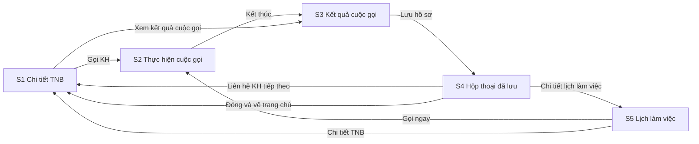

# Interaction Spec

Tài liệu này mô tả tương tác của các màn S0–S6 (xem `mockups.md`). Mỗi thành phần được viết theo mẫu component spec (rút gọn). Hành vi bám theo `stories.md` và `requirements.md`.

## 1. Luồng chính

<!-- Text fallback: Từ S1, RM bấm Gọi KH để sang S2. Khi bấm Kết thúc, màn chuyển sang S3. Lưu hồ sơ ở S3 mở hộp thoại S4. Từ S4, RM có ba hướng: sang lead kế tiếp (S1), mở lịch làm việc (S5), hoặc đóng để về S1. Ở S5, nút Gọi ngay mở S2 và nút Chi tiết TNB mở S1. Từ lịch sử hoạt động ở S1, liên kết Xem kết quả cuộc gọi mở lại S3. -->

## 2. Hành vi theo màn

### 2.1 S2 — Thực hiện cuộc gọi
1. Khi mở màn, đồng hồ bắt đầu chạy từ 00:00, ô nhập Copilot nhận focus sẵn, và trình duyệt lắng nghe sự kiện cuộc gọi qua SSE (luồng hiện có).
2. Có hai cách kết thúc: RM bấm **Kết thúc**, hoặc nhận sự kiện `end` từ MicroSIP. Cả hai đều gọi API kết thúc cuộc gọi đúng một lần (khóa phía client, phía server cũng xử lý idempotent), rồi chuyển sang S3 (AC1.1.2, AC1.1.3).
3. Copilot:
   - Bấm Enter hoặc nút gửi thì câu hỏi được gửi đi.
   - Trong lúc chờ trả lời, ô nhập bị khóa và hiện bong bóng "Đang tìm…".
   - Chỉ cho phép một câu hỏi tại một thời điểm.
   - Bấm vào chip gợi ý thì câu hỏi đó được gửi ngay (AC1.3.1).
   - Lịch sử tra cứu chỉ lưu trong phiên hiện tại, câu mới nhất ở trên cùng (AC1.3.2).
   - Nút "Cuộc trò chuyện mới" xóa ngữ cảnh hỏi đáp (AC1.3.3).

### 2.2 S3 — Tiến trình pipeline
- Trình duyệt hỏi trạng thái mỗi 3 giây cho đến khi pipeline kết thúc (Hoàn tất / Không có ghi âm / Lỗi STT / Lỗi AI). Cách này giống `pollUntilReady` đang dùng.
- Thanh tiến trình có 3 bước. Bước nào xong thì hiện ✓, bước đang chạy hiện vòng xoay. Mỗi lần đổi bước, hệ thống thông báo qua vùng `aria-live="polite"`.
- Khi có kết quả, cột 1 và cột 3 được điền dữ liệu, kèm hiệu ứng mờ dần 200 ms. Hiệu ứng tắt nếu người dùng bật `prefers-reduced-motion`.

### 2.3 S3 — Hiển thị khi lỗi (bám bảng FR4.8)

| Tình huống | Cột 1 | Cột 2 | Cột 3 |
|---|---|---|---|
| Không có ghi âm | Hộp xám: "Chưa có điểm AI — không có ghi âm" | Hộp xám: "Không tìm thấy ghi âm cho cuộc gọi này" (không có trình phát) | Form trống, thanh trên báo "Hãy nhập tay kết quả cuộc gọi" |
| STT lỗi | "Chưa có điểm AI — chưa có transcript" | Có trình phát và nút tải `.wav`; hộp vàng "Không chuyển được giọng nói thành văn bản" | Form trống |
| LLM lỗi / quá thời gian | "Chưa có điểm AI" | Có trình phát và transcript đầy đủ | Form trống; nút phụ **"Thử phân tích AI lại"** ở đầu cột |

Bấm "Thử phân tích AI lại" thì cột 1 và cột 3 chuyển sang trạng thái đang tải. Khi có kết quả, hệ thống chỉ điền vào những trường RM chưa nhập, rồi hiện toast "Đã điền N trường từ AI" (AC2.4.3).

### 2.4 S3 — Lưu hồ sơ
1. Bấm "Lưu hồ sơ cuộc gọi" thì hệ thống kiểm tra phía client hai trường bắt buộc.
2. Nếu thiếu, trang cuộn tới trường lỗi đầu tiên, đặt focus vào đó, hiện lỗi ngay dưới trường và **không xóa dữ liệu đã nhập** (AC2.3.5). Server cũng kiểm tra lại hai trường này.
3. Nếu hợp lệ, nút bị khóa và hiện vòng xoay. Lưu thành công thì mở S4. Lưu lỗi thì hiện toast đỏ, mở khóa nút và giữ nguyên dữ liệu.

### 2.5 S5 — Lịch
- Nút ‹ › chuyển sang tuần trước hoặc tuần sau. Nút "Hôm nay" quay về tuần hiện tại.
- Bấm vào một ô công việc thì mở popover chi tiết, gồm các nút: Đã xong / Đổi giờ / Gọi ngay (nếu công việc có lead) / Chi tiết TNB.
- Khi bấm "Đã xong", trạng thái được cập nhật ngay trên giao diện. Nếu API lỗi thì hoàn tác thay đổi và hiện toast lỗi.
- Khi mở từ S4, các công việc vừa tạo nhấp nháy viền xanh 2 lần. Hiệu ứng tắt nếu bật `prefers-reduced-motion`.

## 3. Đặc tả thành phần (rút gọn)

### PipelineStatus
| Trường | Giá trị |
|---|---|
| Phân loại | feedback |
| Trạng thái | processing (từng bước) / done / no-recording / stt-error / ai-error |
| Đầu vào | `status`, `step` |
| Truy cập | `role="status"`, `aria-live="polite"`; mỗi trạng thái luôn có chữ đi kèm icon |

### AudioPlayer
| Trường | Giá trị |
|---|---|
| Phân loại | display / input |
| Trạng thái | default, playing, paused, loading, error (không tải được file), disabled (không có ghi âm) |
| Đầu vào | `src`, `durationMs`, `onTimeUpdate` |
| Bàn phím | Space: phát / tạm dừng; ← / →: tua 5 giây; nút tốc độ xoay vòng 0.75x / 1x / 1.25x / 1.5x / 2x |
| Truy cập | Nút có `aria-label` "Phát ghi âm" / "Tạm dừng"; thời gian hiển thị dưới dạng chữ |

### TranscriptList
| Trường | Giá trị |
|---|---|
| Trạng thái | loading, empty ("Chưa có transcript"), populated, active-turn (Could) |
| Đầu vào | `turns[{speaker, startMs, text}]`, `currentMs` |
| Tương tác | Bấm vào mốc thời gian của một lượt thì trình phát tua tới đúng thời điểm đó |
| Truy cập | Danh sách `<ol>`; nhãn người nói "RM" hoặc "KH" là chữ, không chỉ dựa vào màu |

### ScoreCard
| Trường | Giá trị |
|---|---|
| Trạng thái | loading, scored, unavailable ("Chưa có điểm AI …") |
| Đầu vào | `criteria[5]{name, score0to10}`, `tone`, `insight{strength, improvement}` |
| Quy tắc | Điểm tổng = round(tổng × 2); hạng A ≥ 85, B 70–84, C 50–69, D < 50. Các con số này là đề xuất cho demo, có thể cấu hình |
| Truy cập | Vòng điểm có `aria-label="Điểm cuộc gọi 96 trên 100, hạng A"` |

### KeyinField
| Trường | Giá trị |
|---|---|
| Trạng thái | empty, ai-filled (huy hiệu `AI · mm:ss`), rm-edited (huy hiệu `RM đã sửa`), invalid, disabled (đang lưu) |
| Đầu vào | `label`, `type` (text / number / select / date / textarea), `required`, `aiValue`, `aiSourceMs` |
| Hành vi | Khi RM thay đổi giá trị so với `aiValue`, trạng thái chuyển sang rm-edited |
| Truy cập | `<label for>`; trường bắt buộc có `aria-required="true"`; lỗi nối vào trường qua `aria-describedby` |

### NextTaskList
| Trường | Giá trị |
|---|---|
| Trạng thái | empty ("Chưa có công việc tiếp theo"), populated, row-invalid |
| Đầu vào | `tasks[{title, dueAt, type, priority, ai}]` |
| Hành vi | Có thể thêm hoặc xóa dòng. Dòng nào thiếu tiêu đề hoặc ngày giờ thì báo lỗi ngay trên dòng đó |

### CopilotChat
| Trường | Giá trị |
|---|---|
| Trạng thái | idle (hiện câu gợi ý), waiting, answered (có nguồn), not-found, error, history |
| Đầu vào | `messages[]`, `suggestions[]`, `sessionHistory[]` |
| Truy cập | Vùng tin nhắn có `role="log"` và `aria-live="polite"`; ô nhập có nhãn ẩn "Hỏi Copilot về sản phẩm, chính sách" |

### CalendarWeek / TaskCard
| Trường | Giá trị |
|---|---|
| Trạng thái | loading, empty, populated, overlap (+N), task: upcoming / done / just-created |
| Đầu vào | `weekStart`, `tasks[]`, `filter`, `view` (week mặc định; day / month / list là mức Should) |
| Bàn phím | Tab đi qua từng công việc theo thứ tự thời gian; Enter mở popover; Esc đóng popover |
| Truy cập | Mỗi thẻ có `aria-label` đầy đủ, ví dụ "Nhắc gọi, Thứ 2 09:00, Chốt deal mở sổ, ưu tiên cao" |

### SaveSuccessModal (S4) / TaskModal (S6)
| Trường | Giá trị |
|---|---|
| Phân loại | feedback / input |
| Truy cập | `role="dialog"`, `aria-modal="true"`; focus không thoát ra ngoài hộp thoại; Esc để đóng; đóng xong thì focus quay về nút đã mở hộp thoại |
| Hành vi | Bấm ra nền ngoài: S4 thì đóng, S6 thì hỏi lại nếu đã có thay đổi |

## Sources

- `mockups.md`; `stories.md` (US1–US4, các mã AC được dẫn ở trên); `requirements.md` (FR4.8, FR4.9, NFR3, NFR5); `team-practices.md`.
