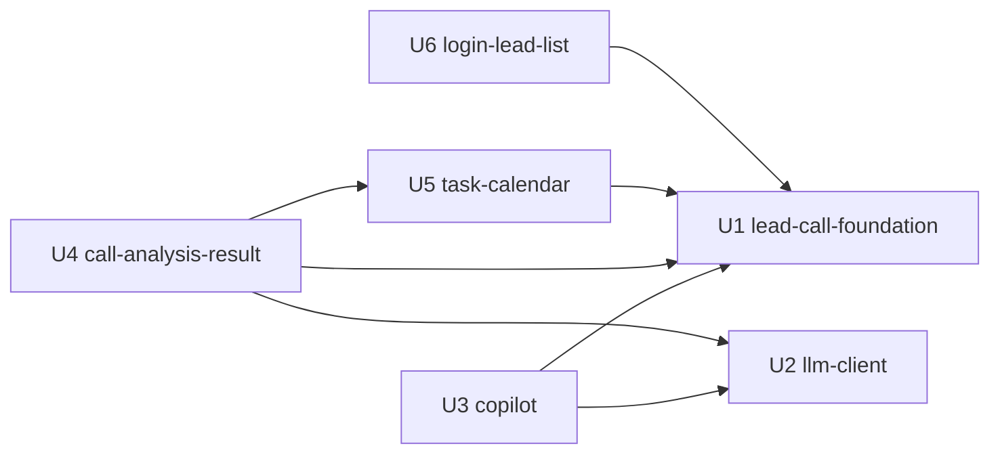

# Unit Dependencies

Tài liệu này chỉ mô tả **topo** (unit nào phụ thuộc unit nào). Thứ tự làm việc do bước Delivery Planning quyết định. Phụ thuộc được suy ra từ các cạnh `depends_on` trong `components.md` và cách gom thành phần vào unit trong `unit-of-work.md`.

```yaml
units:
  - name: u1-lead-call-foundation
    kind: service
    depends_on: []
  - name: u2-llm-client
    kind: library
    depends_on: []
  - name: u3-copilot
    kind: service
    depends_on: [u1-lead-call-foundation, u2-llm-client]
  - name: u4-call-analysis-result
    kind: service
    depends_on: [u1-lead-call-foundation, u2-llm-client, u5-task-calendar]
  - name: u5-task-calendar
    kind: service
    depends_on: [u1-lead-call-foundation]
  - name: u6-login-lead-list
    kind: service
    depends_on: [u1-lead-call-foundation]
```

## Sơ đồ phụ thuộc


<!-- Text fallback: U1 và U2 không phụ thuộc unit nào. U3 phụ thuộc U1 và U2. U4 phụ thuộc U1, U2 và U5. U5 phụ thuộc U1. U6 phụ thuộc U1. Không có chu trình. -->

## Điểm tích hợp

| Cạnh | Điểm tích hợp | Hình thức |
|---|---|---|
| U3 → U1 | Panel Copilot gắn vào khung màn S2 do U1 dựng; dùng RM và cuộc gọi hiện tại để ghi nhật ký truy vấn | Gọi trong tiến trình (giao diện Java) và gắn vào DOM của S2 |
| U3 → U2 | `LlmClient` dùng để trả lời câu hỏi | Giao diện Java |
| U4 → U1 | Sự kiện kết thúc cuộc gọi kích hoạt pipeline; trạng thái cuộc gọi; ghi Activity và cập nhật giai đoạn lead; khối tóm tắt AI hiển thị trên S1; chọn lead kế tiếp | Giao diện Java (dịch vụ Lead/Call) và API REST cho giao diện |
| U4 → U2 | `LlmClient` dùng để phân tích cuộc gọi | Giao diện Java |
| U4 → U5 | Tạo công việc khi lưu keyin; hộp thoại S4 mở S5 | Giao diện Java (dịch vụ Task) và điều hướng trang |
| U5 → U1 | RM hiện tại; kiểm tra lead thuộc RM; Gọi ngay và Chi tiết TNB mở S2/S1 | Giao diện Java và điều hướng trang |
| U6 → U1 | Thay chế độ `demo` của Auth bằng `login`; thêm cột danh sách lead vào S1 | Cấu hình Auth, API Lead, gắn vào DOM của S1 |

CSDL dùng chung, nhưng mỗi unit chỉ ghi vào bảng của thành phần mình sở hữu. Dữ liệu của thành phần khác phải đi qua dịch vụ của thành phần đó (ADR-001). Hợp đồng chi tiết sẽ chốt ở bước Contract Design.

## Cơ hội phát triển song song

- **{U1, U2}**: không phụ thuộc lẫn nhau, bắt đầu được cùng lúc.
- **{U3, U5, U6}**: chỉ cần U1 (riêng U3 cần thêm U2), và không phụ thuộc lẫn nhau, nên làm song song được sau khi các unit chúng cần đã sẵn sàng.
- **U4** cần U1, U2 và U5. Có thể bắt đầu sớm hơn nếu dùng hợp đồng đã chốt ở Contract Design và bản giả lập của U2 và U5.

Có nhiều thứ tự topo hợp lệ. Việc chọn thứ tự thuộc về bước Delivery Planning.

## Sources

- `components.md`, `decisions.md`, `unit-of-work.md`, `requirements.md`, `stories.md`
