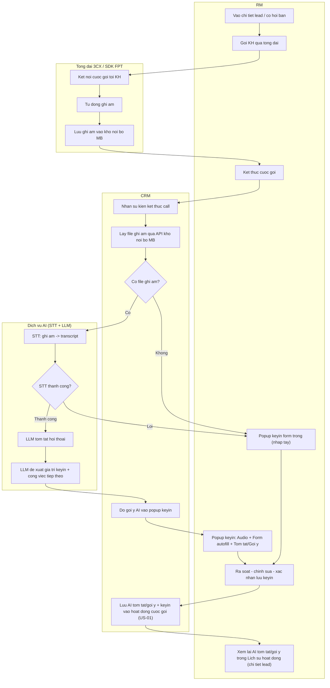

# PHIẾU YÊU CẦU PHÁT TRIỂN PHẦN MỀM (BM.02)

**TÀI LIỆU PHIẾU YÊU CẦU PHÁT TRIỂN PHẦN MỀM**
*(Áp dụng cho các yêu cầu sản phẩm dịch vụ, quy trình mới, tính năng mới hoặc yêu cầu cải tiến)*

> Epic: **(CRM) AI phân tích cuộc gọi RM với Khách hàng** (APP + WEB)
> Trạng thái: **Phase 3 Design.** Phạm vi Epic: **3 US** (US-01, US-02, US-03) — xem mục 4.2. Màn
> quản trị cuộc gọi CBQL (gồm lưu trữ bản ghi đầy đủ) **không thuộc phạm vi Epic này** — xem tầm nhìn
> mở rộng mục 4.4 (draft tham khảo: `BM03-US-CBQL-hoan.md`).
> Tài liệu hiện trạng tham chiếu:
> - [pageId=813014190](https://confluence.mbbank.com.vn/pages/viewpage.action?pageId=813014190) — App - Gọi cho KH qua tổng đài (3CX + SDK FPT, tự động ghi âm) — v61
> - [pageId=536766154](https://confluence.mbbank.com.vn/pages/viewpage.action?pageId=536766154) — [APP RM] Cơ hội bán - Khai báo Giai đoạn và Hoạt động (form keyin hiện tại) — v33

---

## I. THÔNG TIN YÊU CẦU *

| Tên yêu cầu | (CRM) AI phân tích cuộc gọi RM với Khách hàng |
|---|---|
| Loại yêu cầu | Phát triển mới |
| Mức độ yêu cầu | Thông thường |
| Đề xuất ngày Golive | _bổ sung (dự kiến theo kế hoạch mục V)_ |
| **Soạn thảo** | **Đơn vị yêu cầu** |
| Họ và tên | _bổ sung_ |
| Chức danh | _bổ sung_ |
| Phòng/TT/Khối | _bổ sung_ |

| **Phê duyệt** | **Đơn vị yêu cầu** | **Khối Công nghệ thông tin** |
|---|---|---|
| Họ và tên | _bổ sung_ | _bổ sung_ |
| Chức danh | _bổ sung_ | _bổ sung_ |
| Phòng/TT/Khối | _bổ sung_ | _bổ sung_ |
| Ký duyệt | | |

---

## II. MỤC ĐÍCH YÊU CẦU

### 2.1. Mục đích *

**Hiện trạng/vướng mắc:** cuộc gọi KH qua tổng đài (app-to-call 3CX + SDK FPT) **đã tự động ghi âm,
lưu nội bộ MB** nhưng **chưa được khai thác**; sau mỗi call RM phải **gõ tay toàn bộ form keyin** →
tốn thời gian, dễ bỏ sót thông tin, dữ liệu lead không đồng đều; CBQL chưa có công cụ giám sát chất
lượng (chỉ nghe mẫu thủ công một phần nhỏ).

**Mục tiêu:** chèn một **tầng AI phân tích cuộc gọi** vào luồng gọi/keyin đang vận hành để tận dụng
bản ghi âm sẵn có.

**Phạm vi làm trong Epic này (đợt này):**
- **(RM — ưu tiên 1)** Kết thúc call → AI tự phân tích bản ghi và **điền sẵn (autofill) form keyin**
  (giai đoạn/kết quả/công việc) + **gợi ý công việc tiếp theo**; màn "Kết quả cuộc gọi" kèm **AI chấm
  điểm cuộc gọi** (điểm + kỹ năng + cảm xúc KH), **trình phát audio + transcript + tóm tắt/gợi ý**. RM
  chỉ rà soát, sửa, xác nhận → giảm thời gian keyin, tránh bỏ sót. *(US-01)*
- **(RM)** **AI Sales Knowledge Copilot** — chatbot tra cứu chính sách/sản phẩm MB ngay trong cuộc gọi. *(US-02)*
- **(RM)** Xem lại **tóm tắt/gợi ý AI trong Lịch sử hoạt động** ở chi tiết lead. *(US-03)*

**Phần có thể làm ở các đợt sau (tầm nhìn mở rộng — chưa cam kết, xem mục 4.4):**
- **(CBQL)** **AI Tele-Sales Coaching Cockpit** — gồm **màn quản trị cuộc gọi** (list/detail, lọc theo
  miền, nghe lại + lưu gói bản ghi đầy đủ) và dashboard đội → chi tiết RM → hiệu suất cuộc gọi → lộ
  trình coaching/IDP (xây trên dữ liệu điểm AI của US-01).
- Rating KH tự chấm (VoC), CBQL ghi đè/quản trị điểm; cảnh báo tuân thủ, phân tích lý do thất bại,
  gợi ý kịch bản bán, dự báo khả năng chốt, phát hiện cross-sell, QA tự động 100% cuộc gọi.

### 2.2. Khảo sát sơ bộ *

| STT | Nội dung khảo sát | Trả lời |
|---|---|---|
| 1 | Sản phẩm/Tính năng này đã/đã từng xuất hiện ở thị trường Việt Nam chưa? | Có (các giải pháp Conversation Intelligence / Call Analytics đã có trên thị trường) |
| 2 | Đã có mô hình kinh doanh được áp dụng thành công hoặc thất bại ở một đơn vị trong nước chưa? | _bổ sung (cần khảo sát)_ |
| 3 | Sản phẩm này đã được MB phát triển trước đây hay chưa? | Chưa (tính năng AI phân tích cuộc gọi là mới; app-to-call + ghi âm đã có) |
| 4 | Ý tưởng về sản phẩm/tính năng này đã được khảo sát ở tập mẫu chưa? | _bổ sung_ |

---

## III. MỤC TIÊU VÀ TIÊU CHÍ ĐO LƯỜNG HIỆU QUẢ (OKR)

> _Số liệu hiện tại/mục tiêu do Đơn vị yêu cầu bổ sung (C-OKR). Gợi ý bộ tiêu chí dưới đây bám đúng
> ưu tiên: giảm thời gian keyin cho RM + tăng độ tin dùng AI._

### 3.1. Chỉ tiêu về kinh doanh/vận hành/quản trị *

| STT | Nhóm tiêu chí | Tiêu chí đo lường | Cách thức đo lường | Số liệu hiện tại | Mục tiêu đăng ký | Thời gian đo |
|---|---|---|---|---|---|---|
| 1 | Năng suất RM | Thời gian keyin trung bình/cuộc gọi | (Thời điểm lưu keyin − thời điểm kết thúc call) | _bổ sung_ | Giảm _X_% | _bổ sung_ |
| 2 | Chất lượng dữ liệu | Tỷ lệ cuộc gọi có keyin đầy đủ | Số call có keyin đủ trường / tổng call | _bổ sung_ | Tăng lên _X_% | _bổ sung_ |
| 3 | Độ tin dùng AI | Tỷ lệ RM chấp nhận gợi ý AI (không sửa/sửa ít) | Số trường giữ nguyên gợi ý AI / tổng trường AI điền | N/A (mới) | ≥ _X_% | _bổ sung_ |

### 3.2. Chỉ tiêu về Tần suất sử dụng *

| STT | Nhóm tiêu chí | Tiêu chí đo lường | Cách thức đo lường | Số liệu hiện tại | Mục tiêu đăng ký | Thời gian đo |
|---|---|---|---|---|---|---|
| 1 | Tần suất sử dụng | Số cuộc gọi được AI phân tích/tháng | Tổng call đưa qua pipeline AI/tháng | N/A (mới) | _bổ sung_ | _bổ sung_ |
| 2 | Tần suất sử dụng | Số lượt RM dùng Copilot tra cứu chính sách/tháng | Log truy vấn Copilot (US-02) | N/A (mới) | _bổ sung_ | _bổ sung_ |

---

## IV. MÔ TẢ YÊU CẦU

### 4.1. Quy trình nghiệp vụ *

Tính năng chèn một **tầng AI** vào **giữa luồng app-to-call + keyin đang vận hành** (không thay quy
trình gọi/ghi âm/keyin hiện có). Luồng tổng thể:

> _Sơ đồ swimlane dưới đây minh họa luồng **sau cuộc gọi (US-01 + US-03)**. US-02 (Copilot tra cứu
> chính sách) chạy **trong lúc gọi** nên không nằm trong sơ đồ sau-call này. Bản ảnh để publish Confluence:
> `diagrams/swimlane/ai-call-analysis-swimlane.puml` (render ra `.png` khi terminal sẵn sàng:
> `uv run _bmad/dgm/_shared/render_plantuml.py diagrams/swimlane/ai-call-analysis-swimlane.puml --png`)._

> _**US-01** = từ "Goi KH" đến "xac nhan luu keyin" (gom pipeline AI + popup) + lưu AI tóm tắt/gợi ý
> vào hoạt động cuộc gọi (node C8). **US-03** = node A10 (xem lại tóm tắt/gợi ý trong Lịch sử hoạt động),
> đọc dữ liệu C8 do US-01 lưu._

| STT | Tên bước | Đơn vị/Đối tượng thực hiện | Mô tả nghiệp vụ chi tiết | Tài liệu tham chiếu |
|---|---|---|---|---|
| 1 | Thực hiện cuộc gọi | RM | Gọi KH qua app-to-call (đã có); hệ thống tự động ghi âm | pageId 813014190 |
| 2 | Lấy & xử lý bản ghi + keyin có AI hỗ trợ | CRM + Dịch vụ AI + RM | Kết thúc call → CRM lấy ghi âm (API kho nội bộ MB) → STT ra transcript → LLM tóm tắt + đề xuất keyin → popup keyin: Audio + Form autofill (sửa được) + Tóm tắt/Gợi ý; fallback form trống khi không có audio | **US-01**; pageId 536766154; C-STT, C-AUDIO |
| 3 | Lưu AI tóm tắt/gợi ý vào hoạt động cuộc gọi | CRM (tự động, trong US-01) | Khi RM lưu keyin, US-01 **lưu kèm AI tóm tắt + gợi ý vào bản ghi hoạt động cuộc gọi** (đủ để US-03 hiển thị lại). | **US-01** (node C8) |
| 4 | Xem lại tóm tắt/gợi ý AI trong lịch sử lead | RM / người xem lead | Mục Lịch sử hoạt động ở chi tiết lead hiển thị thêm AI tóm tắt/gợi ý của từng cuộc gọi — **đọc dữ liệu do US-01 lưu** | **US-03** |
| — | Tra cứu chính sách/sản phẩm trong lúc gọi | RM | Panel Copilot trong màn thực hiện cuộc gọi: hỏi–đáp chính sách/sản phẩm MB kèm nguồn trích dẫn + hiệu lực (luồng during-call, song song) | **US-02** |

### 4.2. Yêu cầu chi tiết *

> ✅ **PO duyệt phạm vi (2026-10-07).** Chuyển sang Phase 3 — Design (viết BM.03).
>
> **Phạm vi Epic — 3 US** (mỗi US là một lát cắt **demo/nghiệm thu độc lập**; đặc tả chi tiết viết
> riêng từng BM.03):
> - **US-01** — AI autofill form keyin + **AI chấm điểm cuộc gọi** (màn "Kết quả cuộc gọi" 3 cột).
>   Lưu kèm AI tóm tắt/gợi ý vào bản ghi hoạt động để US-03 hiển thị lại.
> - **US-02** — **AI Sales Knowledge Copilot**: chatbot tra cứu chính sách sản phẩm MB ngay trong cuộc gọi.
> - **US-03** — hiển thị AI tóm tắt/gợi ý trong Lịch sử hoạt động chi tiết lead (đọc dữ liệu do US-01 lưu).
>
> ⚠️ **Giới hạn điểm chạm (C-POINT — PO chốt):** chỉ áp dụng cho cuộc gọi phát sinh từ **Chi tiết lead /
> Cơ hội bán**; các điểm chạm khác (KH360...) mở rộng ở đợt sau — dù app-to-call đã hỗ trợ mọi điểm chạm.
>
> _Màn quản trị cuộc gọi CBQL + lưu gói bản ghi đầy đủ **không thuộc Epic này** → tầm nhìn mở rộng
> (mục 4.4); draft tham khảo giữ ở `BM03-US-CBQL-hoan.md`._

| STT | Tên chức năng (US) | Mô tả chức năng | Phân quyền |
|---|---|---|---|
| US-01 | AI autofill form keyin + AI chấm điểm cuộc gọi — màn "Kết quả cuộc gọi" (APP + WEB) | Sau khi kết thúc call: CRM lấy ghi âm → STT → LLM phân tích rồi hiển thị màn **"Kết quả cuộc gọi" 3 cột**: **(1) AI chấm điểm cuộc gọi** (điểm + tiêu chí kỹ năng + cảm xúc KH + insight); **(2) Phân tích hội thoại** (audio + transcript tách lượt RM/KH); **(3) AI Auto Keyin** (điền sẵn form keyin, RM sửa được + đánh dấu trường AI, kèm **vùng RM đánh giá chất lượng AI**). Lưu kèm AI tóm tắt/gợi ý vào bản ghi hoạt động để US-03 hiển thị lại. Xử lý bất đồng bộ + fallback form trống khi không có audio/STT lỗi. *(Chi tiết: BM03-US-01)* | Lead đang ở user nào thì user đó keyin |
| US-02 | AI Sales Knowledge Copilot — chatbot tra cứu chính sách sản phẩm **trong cuộc gọi** (During Call) | Panel trợ lý AI song song trong màn thực hiện cuộc gọi: RM hỏi tự nhiên về chính sách/sản phẩm/lãi suất/phí/điều kiện; chatbot trả lời dựa trên **kho chính sách sản phẩm MB (MB Policy Center)** kèm **nguồn trích dẫn + hiệu lực**, gợi ý câu hỏi tiếp theo, lịch sử tra cứu trong phiên. Mục tiêu: RM tư vấn KH chính xác, cập nhật ngay trong lúc gọi. *(Chi tiết: BM03-US-02)* | RM (trong cuộc gọi); theo phân quyền truy cập chính sách SP |
| US-03 | Hiển thị tóm tắt/gợi ý AI trong Lịch sử hoạt động (chi tiết lead, APP + WEB) | Trong mục **Lịch sử hoạt động** ở chi tiết lead: với mỗi cuộc gọi, hiển thị thêm **AI tóm tắt/gợi ý** (chỉ đọc, thu gọn/mở rộng) — đọc dữ liệu do US-01 lưu. *(Chi tiết: BM03-US-03)* | Theo phân quyền xem chi tiết lead hiện tại |

> **Tiêu chí nghiệm thu (tóm tắt — chi tiết AC ở từng BM.03):**
> - **US-01:** gọi KH → kết thúc → màn "Kết quả cuộc gọi" mở với form điền sẵn + audio + tóm tắt + điểm;
>   RM sửa/lưu được; không có audio vẫn mở được form trống.
> - **US-02:** trong màn thực hiện cuộc gọi, RM hỏi về lãi suất/chính sách → chatbot trả lời đúng từ
>   MB Policy Center kèm nguồn + hiệu lực; có gợi ý câu hỏi tiếp theo.
> - **US-03:** mở chi tiết một lead đã có cuộc gọi → thấy mục AI tóm tắt/gợi ý trong Lịch sử hoạt động.

### 4.3. Yêu cầu về tăng trưởng dữ liệu

> _Đơn vị yêu cầu bổ sung (C-DATA). Epic này chủ yếu lưu **AI tóm tắt + gợi ý + keyin** gắn vào hoạt
> động cuộc gọi (dung lượng nhỏ); việc lưu **gói bản ghi đầy đủ (audio ref + transcript)** thuộc màn
> quản trị CBQL (tầm nhìn mở rộng, mục 4.4) → phần ước lượng dung lượng lưu trữ lớn dời theo đó. Vẫn
> cần ước lượng số cuộc gọi/ngày × thời lượng TB để tính **tải cho dịch vụ STT/LLM** (áp dụng ngay US-01)._

| STT | Tham số | Giá trị |
|---|---|---|
| 1 | Số cuộc gọi/ngày (toàn hàng) | _bổ sung_ |
| 2 | Thời lượng cuộc gọi trung bình | _bổ sung_ |
| 3 | Dung lượng lưu trữ audio/transcript dự kiến | _bổ sung_ |
| 4 | Số user truy cập đồng thời cao điểm | _bổ sung_ |

### 4.4. Tầm nhìn mở rộng (❌ CHƯA THỰC HIỆN ở Epic này — gộp chung, chưa chia pha) *

> ⚠️ **Toàn bộ mục 4.4 KHÔNG thuộc phạm vi triển khai của Epic này.** Phạm vi Epic chỉ gồm 3 US
> (US-01, US-02, US-03) như mục 4.2. Mục này gom chung **danh sách tính năng mở rộng tiềm năng** để
> lãnh đạo thấy giá trị dài hạn và định hướng đầu tư. **Chưa cam kết golive, chưa tách US, chưa ước
> lượng effort** — thứ tự ưu tiên sẽ chốt sau khi Epic này chứng minh độ chính xác AI đạt ngưỡng
> (cổng đo lường). Mỗi hạng mục nêu rõ **mục đích/giá trị kinh doanh** làm căn cứ ưu tiên về sau.
>
> **Điều kiện tiên quyết để mở phần mở rộng:** (1) Epic này đã golive và ổn định; (2) độ chính xác STT +
> autofill + điểm AI đạt ngưỡng tin cậy; (3) đã tích lũy đủ tập dữ liệu transcript thực tế; (4) nguồn
> lực + ngân sách dịch vụ AI được phê duyệt riêng cho phần mở rộng.
>
> _Hầu hết hạng mục dưới đây **xây trên nền dữ liệu điểm AI mà US-01 đã sinh** (điểm 0-100, 5 tiêu chí
> kỹ năng, sentiment/tốc độ nói, AI Insight cho từng cuộc gọi). Phần lớn **không cần màn mới** — chúng
> là widget/tab/báo cáo gắn vào **Coaching Cockpit** (màn trục cho CBQL) hoặc vào màn RM đã có. Cột
> "Nơi hiển thị đề xuất" là gợi ý của BA, chốt lại khi thiết kế._

**① Màn trục — AI Tele-Sales Coaching Cockpit cho CBQL** (ưu tiên mở trước; cụm 4 mockup "AI Tele-Sales
Coaching" đính kèm 2026-10-08). **Đã bao gồm màn quản trị/lưu trữ cuộc gọi** (lưu gói bản ghi đầy đủ
audio/transcript/metadata + list/detail, lọc theo miền, nghe lại, xuất báo cáo ghi âm — draft tham
khảo `BM03-US-CBQL-hoan.md`). 4 màn con:

| Màn con (mockup) | Nội dung chính |
|---|---|
| (1) Dashboard tổng quan đội | KPI đội + AI Insight toàn đội + bảng xếp hạng RM, lọc đội/chi nhánh |
| (2) Chi tiết RM — Tổng quan | Biểu đồ tiến độ điểm theo thời gian + so sánh 5 kỹ năng + AI Coaching Insight (điểm mạnh/cần cải thiện/đề xuất coaching) |
| (3) Chi tiết RM — Hiệu suất cuộc gọi | Phân bố & trạng thái cuộc gọi + AI Call Score + chỉ số cảm xúc KH + danh sách cuộc gọi (nghe lại, xuất báo cáo ghi âm) |
| (4) Chi tiết RM — Coaching & Phát triển | Lộ trình IDP + đề xuất huấn luyện AI + quản lý/lịch sử phiên coaching với delta điểm |

> **Giá trị:** khép **vòng coaching** quy mô toàn hàng — tổng hợp điểm AI theo RM/đội/chi nhánh/thời
> gian → chẩn đoán kỹ năng yếu → kế hoạch phát triển cá nhân → theo dõi delta điểm; thay nghe mẫu thủ
> công. Bao trùm luôn **"coaching tự động"** (phát hiện RM bỏ sót bước → gợi ý cải thiện). Phụ thuộc US-01.

**② Các hạng mục còn lại — gắn vào màn nào** (không cần dựng thêm màn trừ khi ghi rõ):

| Hạng mục | Nơi hiển thị / giao diện đề xuất | Mục đích / Giá trị kinh doanh |
|---|---|---|
| **CBQL ghi đè/điều chỉnh điểm AI, gắn cờ cuộc gọi cần review** | **Trong Cockpit** — màn con (3), thao tác ngay ở chi tiết từng cuộc gọi (không phải màn riêng) | Human-in-the-loop; dữ liệu hiệu chỉnh quay lại cải thiện mô hình |
| **QA tự động 100% cuộc gọi** | **Cơ chế nền** (mọi call đều có điểm) — thể hiện qua danh sách cuộc gọi + cờ review trong Cockpit màn (3) | Mở giám sát chất lượng từ vài % lên toàn bộ cuộc gọi, không tăng nhân sự QA |
| **Cảnh báo tuân thủ** (RM hứa lãi suất/ưu đãi sai, ngôn từ không phù hợp, ép KH) | **Tab/bộ lọc "Cảnh báo tuân thủ"** trong Cockpit + thông báo đẩy cho CBQL | Giảm rủi ro pháp lý/uy tín; phát hiện sớm thay vì hậu kiểm |
| **Phân tích lý do thất bại** (gom lý do KH từ chối theo khối) | **Báo cáo** — tab báo cáo của Cockpit hoặc **crmcore-report** (biểu đồ xu hướng) | Cho lãnh đạo khối bức tranh "vì sao mất khách" để điều chỉnh SP/chính sách |
| **Dự báo khả năng chốt (propensity)** | **Cột/nhãn "độ nóng" lead** ngay trên **danh sách lead / cơ hội bán hiện có** + bộ lọc (không cần màn mới) | Ưu tiên nguồn lực vào lead khả năng chốt cao → tăng năng suất bán |
| **Phát hiện nhu cầu chéo (cross-sell)** | **Không gian RM** — gợi ý sản phẩm ở màn "Kết quả cuộc gọi" (nối tiếp US-01) hoặc chi tiết lead | Nắm nhu cầu tiềm ẩn RM có thể bỏ lỡ → tăng số sản phẩm/KH |
| **Gợi ý kịch bản bán theo ngữ cảnh** (xử lý từ chối) | **Mở rộng Copilot US-02** (trợ lý RM trong cuộc gọi) thay vì màn mới | Nhân rộng cách làm của RM giỏi → tăng tỷ lệ chuyển đổi |
| **Rating KH tự chấm (VoC)** | **Cần kênh ngoài** (IVR bấm phím / SMS) để thu; điểm rating hiển thị lại trong Cockpit màn (3), cạnh AI Call Score | Thu tiếng nói trực tiếp của KH, đối chiếu điểm AI; CSAT cấp cuộc gọi |

> **Lưu ý khi mở phần mở rộng:** cần chốt **khung chuẩn mực kỹ năng RM** (5 tiêu chí + thang điểm),
> **cây phân quyền CBQL theo miền** (ai thấy RM nào — tái dùng crmcore-rm-relationship), nguồn dữ liệu
> lịch sử coaching (tạo mới hay tích hợp MB LMS), và cổng kiểm chứng độ tin cậy điểm AI. **Rating KH
> (VoC)** là hạng mục duy nhất cần tích hợp hệ thống ngoài → tách riêng, effort cao hơn.

---

## V. KẾ HOẠCH TRIỂN KHAI DỰ KIẾN

| STT | Nội dung triển khai | Pha | Kế hoạch dự kiến |
|---|---|---|---|
| 0 | **Quyết định dịch vụ STT + LLM** (mua ngoài / self-host) — đường găng (critical path) | Tiền đề | _cần quyết sớm (C-STT)_ |
| 1 | **US-01** AI autofill keyin + **AI chấm điểm cuộc gọi** — màn "Kết quả cuộc gọi" (APP + WEB) | Đợt này | _bổ sung_ |
| 2 | **US-02** AI Sales Knowledge Copilot — chatbot tra cứu chính sách SP trong cuộc gọi | Đợt này | _bổ sung_ |
| 3 | **US-03** Hiển thị tóm tắt/gợi ý AI trong Lịch sử hoạt động chi tiết lead (đọc dữ liệu US-01) | Đợt này | _bổ sung_ |
| 4 | **Cổng đo lường:** độ chính xác autofill / tỷ lệ RM chấp nhận gợi ý đạt ngưỡng | Gate | _bổ sung_ |
| 5 | **Tầm nhìn mở rộng** (màn quản trị + lưu trữ cuộc gọi CBQL, rating KH + quản trị điểm, cảnh báo tuân thủ, lý do thất bại, kịch bản bán, propensity, cross-sell, QA 100%, Coaching Cockpit cho CBQL) — xem mục 4.4 | Đợt sau | Sau cổng đo lường; chưa cam kết golive, chưa tách US |

---

## VI. NỘI DUNG KHÁC

### Tài liệu bổ sung

| STT | Tên tài liệu | Link | Ghi chú |
|---|---|---|---|
| 1 | App - Gọi cho KH qua tổng đài | [pageId=813014190](https://confluence.mbbank.com.vn/pages/viewpage.action?pageId=813014190) | 3CX + SDK FPT, tự động ghi âm (v61) |
| 2 | Hiện trạng form keyin — APP | [pageId=536766154](https://confluence.mbbank.com.vn/pages/viewpage.action?pageId=536766154) | Giai đoạn/Kết quả/Công việc (v33) |
| 3 | Bản phân tích Intake + Office Hours | `docs/epics/ai-call-analysis/clarification.md` | Nội bộ |
| 4 | MB Policy Center (kho chính sách sản phẩm) | _cần link (C-POLICY)_ | Nguồn tra cứu cho US-02 Copilot |
| 5 | Mockup During Call + Kết quả cuộc gọi | _đính kèm_ | Chuẩn UI cho US-01 (3 cột) + US-02 (panel Copilot) |
| 6 | Mockup AI Tele-Sales Coaching (4 màn: Dashboard đội / Chi tiết RM-Tổng quan / Hiệu suất cuộc gọi / Coaching & Phát triển) | _đính kèm 2026-10-08_ | Định hướng UI cho Coaching Cockpit CBQL (mục 4.4, tầm nhìn mở rộng) — chưa thuộc Epic này |

---

## Phụ lục: Điểm chờ làm rõ (Clarification còn mở)

| # | Nội dung | Trạng thái |
|---|---|---|
| C-STT | **Dịch vụ STT tiếng Việt + LLM**: mua ngoài (Viettel AI / FPT.AI / VNG / Google...) hay self-host? Chất lượng STT trên audio tổng đài là **rủi ro số 1** của Epic. LLM khả năng mua ngoài (chưa chốt). | **Mở** — làm việc với Khối Công nghệ |
| C-AUDIO | **API lấy file ghi âm** từ kho nội bộ MB: tên API/endpoint, định danh cuộc gọi (call-id), định dạng file, độ trễ sẵn sàng sau khi kết thúc call | **Mở** — làm rõ với team app-to-call (tham chiếu tài liệu tích hợp mục 3.1.3.1 của pageId 813014190) |
| C-SEC | **Tuân thủ dữ liệu**: audio đã lưu nội bộ MB; cần xác nhận ràng buộc khi đẩy transcript/nội dung KH qua dịch vụ AI (nhất là nếu LLM mua ngoài) — mã hóa, ẩn PII, lưu vết | **Mở** — rà soát với bộ phận tuân thủ/an ninh thông tin |
| C-CBQL | Màn quản trị cuộc gọi CBQL: xuất Excel / gắn cờ review / danh sách cột | **Ngoài phạm vi Epic** — làm rõ khi mở Coaching Cockpit (mục 4.4) |
| C-OKR | Số liệu OKR mục III (hiện tại + mục tiêu) | **Mở** — Đơn vị yêu cầu bổ sung |
| C-DATA | Tham số tăng trưởng dữ liệu mục 4.3 | **Mở** |
| C-POINT | Phạm vi điểm chạm Epic này | ✅ **Đóng (PO 2026-10-07):** **giới hạn chi tiết lead / cơ hội bán trước**; các điểm chạm khác (KH360...) mở rộng sau. |
| C-HIST | US-03: mục AI tóm tắt/gợi ý trong Lịch sử hoạt động có kèm **link nghe lại audio** không? Hiển thị cho mọi role xem lead hay chỉ RM giữ lead? | **Mở** |
